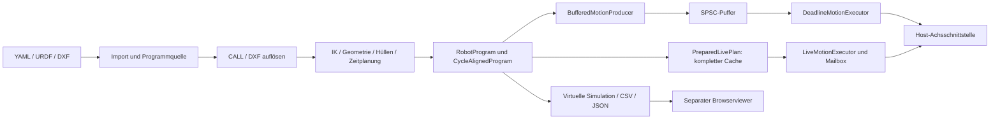
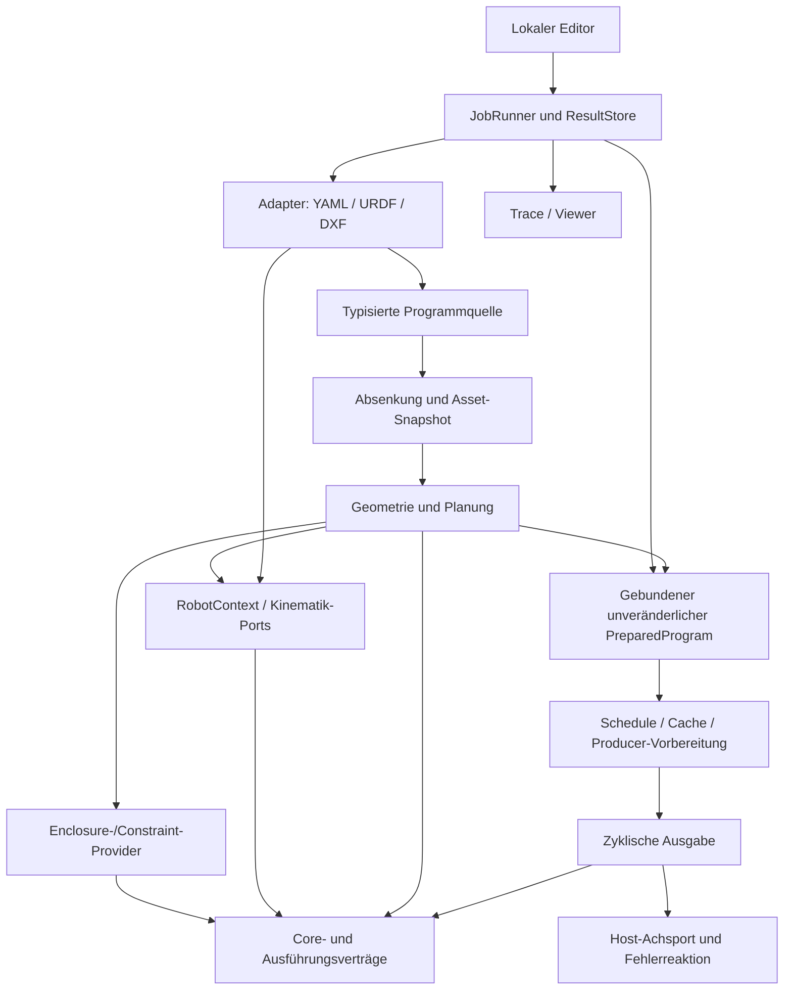

# Architektur-Review Robot Motion C++ 0.13.0

**Stand:** 29.10.2026. **Basis:** Commit `ecf42597e4b0ab4f25516f88cfd7d33dea2b29a9`, Bibliothek 0.13.0, Testwerkzeug 0.4.0.
**Arbeitsweise im ursprünglichen Review:** Quellcode und Repository blieben unverändert. Prüfprogramme und Bericht lagen außerhalb des Projekts. Bestehende Build-Artefakte wurden verwendet; kein vollständiger Clean-Build im Review.

**Nachtrag 30.10.2026:** Der historische Bericht wird jetzt im Repository gesichert. Er beschreibt weiterhin ausschließlich `ecf4259`. Die Behebung von F01/F02/F06/F09 sowie ihre verbleibenden Grenzen stehen im [separaten Umsetzungsnachweis](../testing/architecture_review_fixes.md); die ursprünglichen Bewertungen werden nicht nachträglich überschrieben.

Kennzeichnung: **R** = in diesem Review reproduziert; **B** = unmittelbar im Code nachgewiesen; **A** = begründete Risikoeinschätzung; **O** = offene Anforderung. Bewertungen sind technische Urteile, keine Zertifizierung oder gemessene Hardwarefreigabe.

## A. Executive Summary

Die Architektur ist eine brauchbare Grundlage für modellbasierte Bewegungsplanung und Simulation. Besonders stark sind die bewusste Trennung zwischen allokierender Vorbereitung und fester zyklischer Ausgabe, verriegelte Ausführungsfehler, Quellortdiagnosen, unabhängige KDL-Vergleiche, begrenzte Parser und die vollständig getrennte Visualisierung.

Sie ist aber noch keine konsequent durchgesetzte Modularchitektur: Include-Abhängigkeiten zwischen Aufgabenbereichen sind zyklisch; die Bibliothek bündelt Kinematik, Import, Kalibrierung und Programmverarbeitung in einem Target. Erweiterungsschnittstellen sind teilweise generisch benannt, setzen intern jedoch konkrete Typen und ungeprüfte Datenformen voraus.

**Vor der nächsten Steuerungsintegration zuerst beheben:**

1. Speicherunsicherheit an Provider-Grenzen: fehlerhafte Schedule-/Path-Implementierungen führen zu Undefined Behavior statt einem Fehlerresultat.
2. Fehlende Bindung zwischen Programmreferenz und Schedule: zwei einzeln gültige Programme lassen sich zu einer erfolgreich simulierten, aber falsch beschriebenen Kombination verbinden.

Zusätzlich reproduziert: NaN-Erfolg im älteren Tracking-Prädiktor sowie widersprüchliche Veröffentlichung bei einem Aufräumfehler des Editors. Keine dieser Feststellungen wird durch eine grüne Beispielsuite ausgeschlossen: Die vorhandenen Bibliothekstests bestehen hier mit **29/29**.

Empfehlung: keine Neuentwicklung. Zuerst Invarianten und Ergebnisidentität härten, anschließend Abhängigkeitsrichtungen und ausgewählte Erweiterungspunkte verbessern. Die bewährten Algorithmen und Echtzeitgrenzen erhalten.

## B. Architekturübersicht

### Komponenten und Verantwortungen

| Bereich | Tatsächliche Aufgabe und wesentliche Abhängigkeiten |
| --- | --- |
| `core/` | Zustände, Grenzen, Pose, Uhrdomäne; enthält auch IKinematics und die konkrete CartesianGantry-Kinematik |
| `math/`, `kinematics/` | Ableitungs-Jets, FK/J/IK, Referenzkinematiken, Intervallabbildung; Eigen in kompilierten seriellen Funktionen |
| `planning/` | Gelenkquintiken, Posegeometrie, IK-Spline-Abbildung, Zeitparametrisierung, Hüllen, optionale Ruckig-Generatoren/Stopps |
| `io/` | URDF-/SI-YAML- und DXF-Import, Dateizugriff, Datenvalidierung |
| `program/` | YAML-Programm, CALL-/DXF-Auflösung, Gesamtplanung, Referenz und Simulation |
| `execution/` | Zeitraster, SPSC-Puffer, Deadline-Ausgabe, vorberechneter Live-Cache, Planwechsel, Stop-Schedules |
| `tracking/`, `calibration/` | Beobachtungshistorie und Vorhersage, statische Frames, Kalibrierfit, Moving-Horizon-Planung |
| `platform/` | Linux-Monotonuhr, absolutes Warten und Einrichtung von Affinität/FIFO/mlock |
| `tools/motion_viewer/` | Lokaler Python-Dienst, nativer Exporter, Browsereditor, Offline-Viewer und UR-Meshes |
| Tests/Build | CMake-Matrix, Sanitizer, Programm-/DXF-Fuzzing, unabhängiges KDL, Header-/Dokumentations- und Consumerprüfungen |

Die Python-Oberfläche verwendet die Standardbibliothek; Three.js ist lokal mitgeliefert. Ruckig ist optional. KDL ist eine Testabhängigkeit. Eigen, yaml-cpp und tinyxml2 werden über lokale, hashgebundene Quellarchive eingebunden. Das ist für reproduzierbare Offline-Builds positiv; es ersetzt keinen Wartungsprozess für aktualisierte Abhängigkeiten.

### Daten- und Kontrollfluss

Planung und Sampling dürfen allokieren und werfen. Der zyklische Pfad kopiert feste Arrays und prüft Zeit/Tick/Zustand. Die konkrete Achsannahme und Reaktion nach Ablehnung gehören dem Host. Das ist dokumentiert und nicht mit einer bereits vorhandenen Feldbusintegration zu verwechseln.

Im Live-Pfad besitzen Anwendung/Planmanager die Caches. Der Executor leiht Zeiger; Rückmeldungen bestimmen, wann alte Generationen freigegeben werden dürfen. Das vermeidet Referenzzählung und Freigaben im zyklischen Thread. Es verlangt einen korrekten Besitzer und eine definierte Abschaltfolge. Nur `snapshot()` ist für nebenläufige Beobachtung freigegeben. SPSC und Mailbox benötigen die vereinbarte Eigentümer-/Threadzuordnung.

Im Editor serialisiert ein Lock Simulationsaufträge. Ergebnisse haben unveränderliche URLs, drei Stände werden aufbewahrt. Browserentwurf und simulierte Quelltext-/DXF-Schnappschüsse sind getrennt; das verhindert ein Überschreiben während der Planung.

### Zentrale Entscheidungen und Auswirkungen

| Entscheidung | Nutzen | Preis / Grenze |
| --- | --- | --- |
| Vorbereitung außerhalb des zyklischen Threads | Begrenzter Ausgabeaufwand, keine IK/Dateioperationen im Poll | Separater Ressourcenbedarf für die Vorbereitung |
| Feste Arrays und geliehene Live-Caches | Kein Heap-/shared_ptr-Lebenszyklus im Poll | Lebensdauer muss außerhalb korrekt verwaltet werden |
| Zwei Ausgabewege: Ring und Vollcache | Streaming versus deterministischer Planwechsel | Unterschiedliche Validierung und Speichermodelle |
| Stillstand an Programmsegmentgrenzen | Einfache Übergaben, klare Grenzen | DXF hat Stops an Teilstücken; kontinuierliche Bearbeitung braucht einen eigenen Vertrag |
| Numerische IK und Hüllen | Viele serielle Modelle mit gemeinsamer Implementierung | Lokale Suche, mögliche konservative Ablehnung, keine formale Intervallzertifizierung |
| Headerbasierte Algorithmen, gemeinsames Serial-Target | Einfacher Quellcodeeinbau und Templates | Hohe transitive Abhängigkeiten und grobe Build-Grenzen |
| Eigenes striktes SI-Programmformat | Klare Einheiten und begrenzte Ausführung | Eigene AST-/Schema-/Migrationspflege |
| Lokales Testwerkzeug | Keine Produktions-Webplattform notwendig | Ein Job gleichzeitig; nicht als Mehrbenutzer-Server ausgelegt |

### Nachgemessene Abhängigkeiten

71 öffentliche Header, davon 37 kanonisch und 34 Weiterleitungen. Im untersuchten direkten Include-Graph gibt es **keinen Dateizyklus**. Auf Ebene der Aufgabenordner ergeben sich jedoch zwei zyklische Komponenten:

- `execution ↔ program`: CycleAlignedProgram kennt IJointProgram, das Programm kennt das Ausführungsraster.
- `kinematics ↔ math ↔ planning`: insbesondere Intervall-Kinematik, Ableitungs-Jets und Polynomial-/Spline-Typen.

Diese Analyse zählt auch bedingte Includes; sie beschreibt Quellabhängigkeiten, keine behauptete zyklische Laufzeitausführung. Beispiel: [Intervall-Kinematik](https://github.com/cpr-jar/Robotmotionplanning/blob/ecf42597e4b0ab4f25516f88cfd7d33dea2b29a9/include/motion/kinematics/interval_kinematics.hpp#L1), [CycleAlignedProgram](https://github.com/cpr-jar/Robotmotionplanning/blob/ecf42597e4b0ab4f25516f88cfd7d33dea2b29a9/include/motion/execution/cycle_aligned_program.hpp#L1).

## C. Qualitätsbewertung

Skala: 1 = erheblicher Handlungsbedarf, 3 = brauchbare Basis mit strukturellen Grenzen, 5 = für den betrachteten Bedarf sehr gut abgesichert.

| Kriterium | Wert | Begründung am Code |
| --- | ---: | --- |
| Modularität | 3 | Aufgabenordner und getrennte Tools sind vorhanden; zwei Modulzyklen und gemeinsames Serial-Target verhindern eine entsprechende Komponententrennung. |
| Separation of Concerns | 3 | Vorbereitung/Ausgabe sauber getrennt; Compiler kennt Importdaten und Dateipfade, Editor-Service kombiniert Ausführung und Ergebnisaufbewahrung. |
| Kopplung | 2 | Intervallabbildung kennt konkrete Kinematiken; RobotProgram hält ImportedSerialRobot; Math importiert Kinematik. |
| Kohäsion | 3 | Die meisten Algorithmen sind fachlich zusammenhängend; Core enthält konkrete Kinematik, AST enthält CAD-Quellen und bereits abgesenkte Bewegungsdaten. |
| Erweiterbarkeit | 3 | Gute Ausgangsports IKinematics/Trajektorie/Schedule; zusätzliche Kinematiken benötigen trotzdem zentrale Änderungen. |
| Wartbarkeit | 3 | Überschaubare Dateien und dokumentierte Verträge; verteilte Validierung, Status-/Diagnoseformen und Policy-Konstanten erhöhen Änderungsaufwand. |
| Testbarkeit | 4 | Kleine Interfaces, KDL-Referenz, Fuzzing, Sanitizer und virtuelle Uhren; Negativverträge fremder Provider und Fehler bei Ergebnis-GC fehlen. |
| Wiederverwendbarkeit | 3 | CMake-Fassade, optionale Features und kompatible Header; Programme serial-spezifisch, keine eigene installierbare Komponentenpaketierung. |
| Robustheit | 2 | Mitgelieferte Pfade gut geprüft und Fehler verriegelt; an öffentlichen Erweiterungsgrenzen sind Speicherfehler und falsche Erfolgsergebnisse reproduzierbar. |
| Performance | 3 | Fester zyklischer Pfad; umfangreiche Vollcaches, vollständige Python-Spurmaterialisierung und wiederholte UI-/IK-Arbeit. Kein Pi-WCET im Review. |
| Skalierbarkeit | 3 | Lokale Budgets und Begrenzungen vorhanden; kein durchgehendes Budget/Cancellation über alle Vorbereitungsphasen. |
| Verständlichkeit | 4 | Gute Dokumentation, acht Klassensichten und Tutorial; Quellen-/Plan-/Schedule-Identität und doppelte Tracking-APIs bleiben erklärungsbedürftig. |

## D. Architekturprobleme

### F01 — Ungeprüfte Formen an Erweiterungsschnittstellen — P1, R/B

[prepare_live_plan](https://github.com/cpr-jar/Robotmotionplanning/blob/ecf42597e4b0ab4f25516f88cfd7d33dea2b29a9/include/motion/execution/live_motion_executor.hpp#L46) prüft N gegen den Anfangszustand, nicht gegen jeden späteren Zustand und den Limitvektor, bevor [std::copy](https://github.com/cpr-jar/Robotmotionplanning/blob/ecf42597e4b0ab4f25516f88cfd7d33dea2b29a9/include/motion/execution/live_motion_executor.hpp#L74) in feste Arrays schreibt. Ein Test-Schedule mit Anfangsdimension 1, Limits/Samples der Dimension 64 führt unter ASan zu einem **stack-buffer-overflow**. Im Ring-Produzenten existiert der entsprechende q-Größencheck bereits.

[PathTimeParameterizer::plan](https://github.com/cpr-jar/Robotmotionplanning/blob/ecf42597e4b0ab4f25516f88cfd7d33dea2b29a9/include/motion/planning/path_time_parameterization.hpp#L75) prüft Bounds-Größen, verwendet aber `initial.q[i]` ungeprüft. Eine Path-Implementierung mit leerem evaluate(0)-Ergebnis führt zu einer **UBSan-Nullreferenz**. Ähnliche ungeprüfte Plugin-Rückgaben stehen in der IK-Spline-Konstruktion.

Das setzt einen fehlerhaften fremden Provider voraus; es ist kein beobachteter Absturz eines mitgelieferten Beispiels. Gerade solche Adapter sollen über die Interfaces austauschbar sein. Der erwartete Fehlerpfad liefert Result/Diagnose; er schützt hier nicht vor UB.

### F02 — Programm und Schedule sind nicht identitätsgebunden — P1, R/B

[PreparedRobotProgram](https://github.com/cpr-jar/Robotmotionplanning/blob/ecf42597e4b0ab4f25516f88cfd7d33dea2b29a9/include/motion/program/robot_program.hpp#L71) ist ein öffentlich veränderbares Paar. [simulate_robot_program](https://github.com/cpr-jar/Robotmotionplanning/blob/ecf42597e4b0ab4f25516f88cfd7d33dea2b29a9/src/program/program_simulation.cpp#L109) prüft Zeiger und Tickbudget, nicht die gemeinsame Herkunft. Die Simulation nimmt Befehle aus dem Schedule, Ruck/Quellorte aber aus der Referenz.

Reproduktion aus zwei **gültigen** Programmen: A = WAIT bei q0=0,2; B = PTP nach q0=0,21. `{A.reference, B.schedule}` wird erfolgreich simuliert: Endstellung 0,21, gemeldeter Spitzenruck 0. Der korrekte B-Vergleichslauf meldet ca. **1,48066 rad/s³**. Das beweist falsche Programm-/Diagnosezuordnung, nicht eine gemessene physische Grenzverletzung.

### F03 — Ordner sind noch keine azyklischen Module — P2, B

[Serial-Target](https://github.com/cpr-jar/Robotmotionplanning/blob/ecf42597e4b0ab4f25516f88cfd7d33dea2b29a9/src/CMakeLists.txt#L1) kompiliert Kinematik, Kalibrierung, YAML/XML/DXF und Programmlauf. [Math](https://github.com/cpr-jar/Robotmotionplanning/blob/ecf42597e4b0ab4f25516f88cfd7d33dea2b29a9/include/motion/math/derivative_jets.hpp#L1) hängt an Kinematik; Intervall-Kinematik an Planungs-Polynomen. Kleine Verträge liegen in implementationsnahen Headers.

Risiko: neue Komponenten lassen sich nicht unabhängig bauen/ersetzen; Änderungen an zentralen Headers verbreiten sich stark. Bei statischer Bindung wird nicht zwangsläufig der gesamte Parsercode in jede Anwendung übernommen; die unnötige Build-/Nutzungsabhängigkeit besteht trotzdem.

### F04 — Austauschbare Kinematik endet an konkreten Typen — P2, B

[enclosure::evaluate](https://github.com/cpr-jar/Robotmotionplanning/blob/ecf42597e4b0ab4f25516f88cfd7d33dea2b29a9/include/motion/kinematics/interval_kinematics.hpp#L126) verzweigt per dynamic_cast auf Gantry, SCARA, Delta und Serial. Für einen neuen, korrekt implementierten IKinematics-/IDifferentialKinematics-Typ existiert kein gleichrangiger Enclosure-Port. Die sichere Ablehnung unbekannter Modelle ist richtig; die zentrale Typkenntnis begrenzt Erweiterbarkeit.

[RobotProgram](https://github.com/cpr-jar/Robotmotionplanning/blob/ecf42597e4b0ab4f25516f88cfd7d33dea2b29a9/include/motion/program/robot_program.hpp#L100) besitzt außerdem ImportedSerialRobot, sodass das generische Programmformat an ein konkretes Importergebnis gekoppelt ist.

### F05 — AST, Absenkung und Planungsinvarianten vermischt — P2, B/A

[ProgramInstruction](https://github.com/cpr-jar/Robotmotionplanning/blob/ecf42597e4b0ab4f25516f88cfd7d33dea2b29a9/include/motion/program/robot_program.hpp#L34) kombiniert Target-Variant, Kreisfelder, WAIT, optionalen DXF-Befehl und CAD-Start/Quellort. Viele Kombinationen sind sinnlos; sie werden durch Konvention und große Fallunterscheidungen ausgeschlossen.

[Compiler](https://github.com/cpr-jar/Robotmotionplanning/blob/ecf42597e4b0ab4f25516f88cfd7d33dea2b29a9/src/program/program_planning.cpp#L78) übernimmt Motion-Planung, DXF-Dateibeschaffung, Expansion, CAD-Anschlusstoleranzen und Rasterbildung. Die [DXF-Absenkung](https://github.com/cpr-jar/Robotmotionplanning/blob/ecf42597e4b0ab4f25516f88cfd7d33dea2b29a9/src/program/program_dxf.cpp#L4) ist bereits ein guter erster Schnitt. Weitere Befehle würden ansonsten dieselben Kopplungen vergrößern. Kein Befund rechtfertigt dafür eine vollständige Plugin-/Skriptplattform.

### F06 — Älterer Tracking-Port akzeptiert ungültige Daten — P2, R/B

[ConveyorPredictor::predict](https://github.com/cpr-jar/Robotmotionplanning/blob/ecf42597e4b0ab4f25516f88cfd7d33dea2b29a9/include/motion/tracking/constant_velocity_predictor.hpp#L21) prüft Alter, aber nicht Endlichkeit. NaN als future_time ergibt `optional.has_value()==true` mit NaN-Position. Der neuere ConveyorTargetPredictor validiert solche Größen ausdrücklich.

Risiko: zwei öffentliche, ähnlich benannte Wege haben unterschiedliche Erfolgsgarantien. Nachgelagerte Planer können NaN nochmals ablehnen; der Legacy-Port selbst meldet dennoch Erfolg. Kompatibilität verlangt Validierung und klare Kennzeichnung, nicht kommentarloses Entfernen.

### F07 — Solveroption ohne Wirkung — P2, B

[prismatic_scale_m](https://github.com/cpr-jar/Robotmotionplanning/blob/ecf42597e4b0ab4f25516f88cfd7d33dea2b29a9/include/motion/kinematics/serial_chain_kinematics.hpp#L12) wird importiert und validiert, aber in [ik_detailed](https://github.com/cpr-jar/Robotmotionplanning/blob/ecf42597e4b0ab4f25516f88cfd7d33dea2b29a9/src/kinematics/serial_chain_kinematics.cpp#L157) nicht verwendet. Der Schritt wird anhand der rohen Delta-Norm begrenzt. Die Dokumentation beschreibt Skalierungen für die gemischte Suche.

Damit ist eine öffentliche Konfiguration wirkungslos. Auswirkungen auf Konvergenz konkreter gemischter Modelle wurden hier nicht vermessen; bei rein rotatorischen UR-Modellen ist das kein Nachweis eines aktuellen Bahnfehlers.

### F08 — Lokale Limits statt durchgängiger Ressourcensteuerung — P2, B/A

Budgets existieren, aber [Compiler](https://github.com/cpr-jar/Robotmotionplanning/blob/ecf42597e4b0ab4f25516f88cfd7d33dea2b29a9/src/program/program_planning.cpp#L200), IK/Spline und Ausgabe haben getrennte Zähler. Derselbe DXF-Text wird einmal gelesen, bei jeder Referenz erneut geparst. [prepare_live_plan](https://github.com/cpr-jar/Robotmotionplanning/blob/ecf42597e4b0ab4f25516f88cfd7d33dea2b29a9/include/motion/execution/live_motion_executor.hpp#L67) reserviert den Cache nicht vorab und baut komplette Befehlslisten.

Gemessen: sizeof(FixedJointCommand<6>) = 176 Byte, 200.000 Einträge entsprechen **35,2 MB** reinen Befehlsdaten, ohne Kapazitätsreserve oder parallele Generationen. [prepare_data](https://github.com/cpr-jar/Robotmotionplanning/blob/ecf42597e4b0ab4f25516f88cfd7d33dea2b29a9/tools/motion_viewer/create_viewer.py#L143) materialisiert alle Float-Listen vor der Ausdünnung. Objektgrößen einer echten 54-Spalten-Spur ergeben für 100.000 Zeilen rund **177,8 MiB** allein für Zeilen/Zahlen. Das ist eine Extrapolation, kein gemessener Prozess-RSS oder Pi-Benchmark.

Der [Editor-Timeout](https://github.com/cpr-jar/Robotmotionplanning/blob/ecf42597e4b0ab4f25516f88cfd7d33dea2b29a9/tools/motion_viewer/editor_server.py#L163) begrenzt den nativen subprocess; die nachfolgende Python-Aufbereitung hat kein gemeinsames Gesamtzeit-/RAM-Budget. Ein Auftragsabbruch ist nicht als Workflow verfügbar.

### F09 — Ergebnisveröffentlichung kann nachträglich als Fehler erscheinen — P2, R/B

[SimulationService.simulate](https://github.com/cpr-jar/Robotmotionplanning/blob/ecf42597e4b0ab4f25516f88cfd7d33dea2b29a9/tools/motion_viewer/editor_server.py#L223) registriert das neue Ergebnis und setzt published=True, bevor das Entfernen alter Dateien gelingt. Ein injizierter OSError beim vierten Lauf ergibt HTTP/Service-Fehler 422 „Keine Simulation veröffentlicht“, während das neue Ergebnis intern registriert und der älteste Eintrag entfernt ist.

Damit hängen Veröffentlichung und Aufräumen an derselben Fehlertransaktion. Das betrifft das Testwerkzeug, nicht unmittelbar die zyklische Achsausgabe.

### F10 — Wichtige Nachweise sind noch nicht Teil der CI — P2, B/O

[CI](https://github.com/cpr-jar/Robotmotionplanning/blob/ecf42597e4b0ab4f25516f88cfd7d33dea2b29a9/.github/workflows/build.yml#L1) prüft Buildvarianten, ASan/UBSan, Fuzzing, KDL und Consumer. Das ist stark. Browserprüfungen werden jedoch nicht ausgeführt: der Viewer-Job startet nur unittest, die drei Smoke-Skripte liegen außerhalb dessen Discovery. Ein ThreadSanitizer-Lauf, ARM64-Ausführung und Zielplattform-WCET fehlen.

Das ist keine Behauptung eines Datenrennens. Nebenläufigkeitsprotokolle und Linux/x86-Tests sind kein Ersatz für diese Nachweise. CANopen ist ausdrücklich zurückgestellt und wird hier nicht als fehlgeschlagene Anforderung bewertet.

### F11 — Diagnose- und Policy-Verträge sind verstreut — P2, B

PlanResult/weitere Result-Typen, Exceptions mit Quellort und kompakte ExecutionFaults sind für ihre Bereiche sinnvoll. Problematisch sind Informationsverluste: [BufferedMotionProducer::fill](https://github.com/cpr-jar/Robotmotionplanning/blob/ecf42597e4b0ab4f25516f88cfd7d33dea2b29a9/include/motion/execution/setpoint_buffer.hpp#L72) reduziert alle Exceptions auf Error; mehrere numerische Rückgaben verdichten Unsupported, Eingabefehler und Budgeterschöpfung zu Infeasible/Text.

Toleranzen und Budgets liegen an mehreren Stellen. Beispielsweise DXF-Eintritt 1e-7 m, nominale Kurvenanschlüsse 1e-6 m, Spline-Toleranz separat. Das kann fachlich richtig sein, braucht aber einen zentral nachvollziehbaren Vertrag statt impliziter Zusammenhänge. Änderungen und Fehlersuche werden sonst teuer.

### F12 — Optionale Verbesserungen ohne Architekturzwang — P3, B/A

- Eigene CMake-Install/Export-Pakete fehlen; `add_subdirectory` ist vorhanden und für den heutigen Bedarf brauchbar.
- [paint()](https://github.com/cpr-jar/Robotmotionplanning/blob/ecf42597e4b0ab4f25516f88cfd7d33dea2b29a9/tools/motion_viewer/web/viewer.js#L536) berechnet Serien und zeichnet Diagramme bei jedem Frame erneut; Vorberechnung und getrennte Cursoraktualisierung sind mögliche Optimierungen.
- [Serielle IK](https://github.com/cpr-jar/Robotmotionplanning/blob/ecf42597e4b0ab4f25516f88cfd7d33dea2b29a9/src/kinematics/serial_chain_kinematics.cpp#L179) bestimmt pro nichtkonvergiertem Iterationspunkt den Rang und anschließend erneut die gewichtete Jacobimatrix/SVD. Wiederverwendung ist möglich; Nutzen erst profilieren.

Diese Punkte rechtfertigen weder ein neues UI-Framework noch eine pauschale Verlagerung aller Headerimplementierungen in .cpp-Dateien.

### Bewusst nicht als bestätigte Defekte gewertet

Keine Dateizyklizität, kein nachgewiesenes Datenrennen im SPSC-/Snapshot-Protokoll, keine belegte globale God Class. Größte numerische Dateien sind nicht allein aufgrund ihrer Länge falsch strukturiert. Statische Archive sind kein Beleg, dass alle Abhängigkeiten in jeder Anwendung vollständig landen. Physische Bremswirkung, vollständige Linkkollision und CANopen wurden nicht als vorhandene Funktion angenommen. Die Host-Policy für Kalibrierungswechsel ist ausdrücklich als offen dokumentiert.

## E. Priorisierte Verbesserungsvorschläge

Aufwände: grobe Personentage inklusive gezielter Tests, keine Terminzusage; etwa ±50 %. Abhängige Maßnahmen sind nicht einfach additiv.

| ID / Priorität | Sollzustand und konkrete Umsetzung | Nutzen / Aufwand |
| --- | --- | --- |
| F01 / P1 | Vorbereitung validiert einmal sämtliche Metadaten, Limits und Zustandsdimensionen/Endlichkeit. Vor jeder Übernahme eines fremden Providerwertes dessen Form prüfen; erst dann feste Arrays bilden. Dasselbe für IK-/Path-Rückgaben. Negativprovider als Tests. | Keine UB durch Adapterfehler; 1–2 PT |
| F02 / P1 | Referenz, Modellkontext und Schedule durch Factory/Identität binden. `retime_program()` liefert wieder einen konsistenten Wert. Übergangsweise Legacy-Struct behalten, am API-Eingang Herkunft prüfen und gemischte Paare ablehnen. | Verlässliche Ausführung/Diagnosezuordnung; 2–4 PT |
| F03 / P2 | IJointProgram, ITrajectory und IExecutionSchedule in ein niedriges Vertragsmodul; elementare Pose-/Jet-Mathematik von konkreter Kinematik trennen. Danach gezielte CMake-Komponenten, Fassade/Forwarder behalten; Abhängigkeitscheck in CI. | Weniger Änderungsradius und eigenständige Nutzung; 3–6 PT |
| F04 / P2 | RobotContext unabhängig vom Importergebnis. Optionale Enclosure-Capability/Provider komponieren; unbekannte Fähigkeiten vor teurer Planung als Unsupported melden. Die bestehenden konkreten Implementierungen weiterverwenden. | Neue Kinematik ohne zentrale Typenliste; 3–5 PT |
| F05 / P2 | Typisierte Quellbefehle per std::variant, getrennte abgesenkte LIN/CIRC/PTP/WAIT-IR samt Provenienz. Assetbeschaffung hinter existierendem Loader, Expansion vor Planer. Keine dynamische Plugin-Registry ohne Bedarf. | Neue Befehle ändern weniger Schichten; 3–6 PT |
| F06 / P2 | Legacy-Prädiktor mit vollständigen finite-/Policy-Checks härten und klar kennzeichnen; API-Kompatibilität bewahren. Gemeinsame Clock-/Pose-Validatoren verwenden. | Einheitliche Erfolgsgarantien; 0,5–1 PT |
| F07 / P2 | Gemischte Gelenkkoordinaten konsistent normieren, einschließlich Jacobispalten und Rücktransformation; alternativ Option bis Umsetzung ausdrücklich deaktivieren/deprecatieren. Einheiten-/Skalierungsinvarianz testen. | Kein wirkungsloser Konfigurationsregler; 1–3 PT |
| F08 / P2 | Durchgängiger PreparationBudget plus Abbruchtoken, an tatsächlichem Zielbedarf bemessen. Geparste Zeichnungen passend zu Datei/Optionen wiederverwenden; Cache reserve/Bytegrenze; Spurprüfung zweipassig/streamend statt alle Zeilen behalten. | Planbarer RAM/CPU/Abbruch; 3–6 PT |
| F09 / P2 | ResultStore mit explizitem Commit. Aufräumen abgelaufener Dateien ist nachgelagerte GC, darf einen bereits veröffentlichten Erfolg nicht in 422 umdeuten. Fehler injizieren, URLs und Aufbewahrung prüfen. | Eindeutige Zustandsübergänge; 0,5–1,5 PT |
| F10 / P2 | Browser-Smokes in CI; separater TSan-Job für Threadprotokolle; ARM64-Lauf und später Pi-Stresstest mit echten Hostbudgets. Ein fehlender Nachweis bleibt sichtbar. | Regressionen in UI/Concurrency/Plattform früher sehen; 2–4 PT ohne Hardwareabnahme |
| F11 / P2 | Nicht-RT-Diagnosen mit stabilem Code, Quellort und Ursache; Domänenstatus behalten, an HTTP/CLI gezielt übersetzen. Benannte Admission-/Budget-Optionen statt verstreuter Konstanten; RT nur feste Fehlercodes. | Bessere Diagnose ohne RT-Allokationen; 1–3 PT |
| F12 / P3 | Install/Export erst bei echtem Packagingbedarf. UI-Datenkurven vorberechnen und Renderarbeit messen. SVD-Redundanz nach Profiling beseitigen. | Messbarer Komfort-/Ressourcennutzen; einzeln 0,5–3 PT |

## F. Zielarchitektur

Die Pfeile beschreiben gewünschte Nutzung; sie begründen nicht automatisch ein eigenes Binary pro Kasten. Ein niedriges Vertrags-/Mathematikmodul, klar getrennte Kinematik-/Import-/Programmbibliotheken und ein schlanker Ausführungspfad reichen zunächst.

- **Ein gemeinsamer Modellkontext:** Achsordnung, Limits, Kinematik, Fähigkeiten und explizite Modell-/Kalibrieridentität. Der Parser erzeugt keine Ausführung und kennt keine Plattform.
- **Ein gebundenes Vorbereitungsergebnis:** Referenz, Schedule, Modellidentität, Zulassungsparameter und Provenienz gehören zusammen. Retiming ist eine Factoryoperation, kein freies Austauschen eines Zeigers.
- **Einfacher Compiler:** Quelle → typisierte Expansion → vorhandene Planer. Bestehende Geometrie und Zeitgesetze bleiben erhalten.
- **RT-Grenze erhalten:** Keine Parser, Vektorsampling, geteilte Besitzverwaltung oder Logs im Poll. Ein nichtzyklischer PlanOwner hält aktive/angebotene/retirierte Caches und koordiniert Antworten/Shutdown. Die Rohzeigertechnik darf intern bestehen bleiben.
- **Testwerkzeug bleibt ein Adapter:** JobRunner, ResultStore und Renderer können getrennt getestet werden; kein Datenbank-, Message-Broker- oder Webframework-Zwang.

| Heute | Ziel | Migrationskosten |
| --- | --- | --- |
| Öffentliches Referenz/Schedule-Paar | Gebundener Wert mit geprüftem Retiming | Neue Factory plus Legacy-Eingangsprüfung |
| Typbasierte Enclosure-Verzweigung | Komponierbare optionale Fähigkeit | Adapter für bestehende Modelle, Vergleichstests |
| Ein gemischter Befehlsdatensatz | Quell-AST und Bewegungs-IR | YAML v1 weiter lesen; Mapping intern umstellen |
| Ordnerzyklen, gemeinsames Serial-Target | Niedrige Verträge und gezielte Targets | Headerweiterleitungen und CMake-Fassade erhalten |
| Lauf/Resultate/GC in einem Service | Kleiner Runner und expliziter Store-Commit | HTTP-Verträge und Downloadformate beibehalten |

Teststrategie: vorhandene KDL-/Fuzz-/Grenz-/Ausführungstests erhalten; negative Provider, vertauschte Planbestandteile, Einheiteninvarianz, Commit-/GC-Fehler und Lifecycle-Tests ergänzen. Tests sollen garantierte Eigenschaften prüfen, nicht private Datenstrukturen nachzeichnen. Eine neue Toy-Kinematik mit eigenem Enclosure-Provider dient als Architekturtest: keine zentrale Typenliste ändern müssen.

## G. Migrationsplan

1. **Fehler zuerst, ohne Modulumbau:** F01/F02, zusätzlich kleine Legacy-/Store-Fixes F06/F09. Gate: schlechte Provider liefern Fehler statt UB; gemischtes Planpaar wird abgelehnt; fehlgeschlagene GC hat eindeutige Antwort. Vorhandene gültige Traces bleiben unverändert.
2. **Vertrags- und Ergebnisgrenzen einführen:** Bound-Plan-Factory, einheitliche Eingangsvalidatoren und strukturierte Nicht-RT-Diagnosen. Bestehende Aufrufe über Adapter erhalten, rohe Struct-Nutzung schrittweise deprecatieren.
3. **Abhängigkeiten entflechten:** Kleine Verträge/Mathematik verschieben, Forwarder behalten; erst dann Targets trennen. Gate: keine Modulzyklen im vereinbarten Schichtenmodell, beide Consumer und die Serial-/Ruckig-Matrix weiter grün.
4. **Nur benötigte Erweiterungspunkte umstellen:** Quell-/Bewegungs-IR und Enclosure-Komposition. Gate: YAML v1/DXF und nominale Roboter liefern dieselben Endzustände und begründeten Zulassungen; neue Toy-Kinematik benötigt keine zentrale Sonderbehandlung.
5. **Ressourcen und CI härten:** Phasenübergreifende Budgets/Abbruch, Streaming-Spur, Browser-/TSan-/ARM64-Jobs. Gate: dokumentierte Zeit-/RAM-Obergrenzen für festgelegte Lastfälle; wiederholbare Abbruch-/Shutdown-Tests.
6. **Konkrete Steuerung separat abnehmen:** Host-PlanOwner, Clock-/Achsschnittstelle, Annahme-/Commitsemantik, reale Stresstests auf dem gewählten Pi-System. CANopen bleibt bis zur expliziten Integrationsphase außerhalb des jetzigen Pakets.

Die Schritte sind nicht als Big-Bang-Branch umzusetzen. F01/F02 und F06/F09 sind weitgehend unabhängige kleine Änderungen. F03 schafft die Grundlage für F04/F05. Ressourcenoptimierungen erst anhand definierter Lastfälle priorisieren. Installierbare Pakete und weitere UI-Zerlegung können warten.

## H. Offene Fragen

Bekannt: selbst entwickelte Steuerung, Raspberry Pi 4B, später SocketCAN/Nanotec C5-E/CSP, Takt 1–20 ms. Diese Angaben müssen nicht erneut erhoben werden.

1. Welches konkrete OS/ABI und PREEMPT_RT-Setup? Welche gemessenen maximalen Ausgabe-/Übernahmelatenzen sind zulässig?
2. Wie quittiert die Host-Achsschnittstelle einen Befehl, wann gilt er als unwiderruflich übernommen und was passiert nach Underflow/Deadline-/Annahmefehler?
3. Wer besitzt angebotene/aktive/retirierte Pläne und wie endet ein ausstehender Wechsel beim Shutdown?
4. Welche Policy gilt für aktive oder bereits vorbereitete Pläne bei Kalibrierungs-/Modellrevision? Der aktuelle Code invalidiert sie ausdrücklich nicht automatisch.
5. Wird künftig nur serielle Kinematik benötigt oder sollen echte externe/geschlossene Kinematiken dieselbe Programmschnittstelle verwenden?
6. Maximale Programm-/DXF-Größe, Vorbereitungszeit, Anzahl gleichzeitiger Pläne und RAM-Budget? Soll der Editor überhaupt auf dem Controller laufen?
7. Sind Stillstandsgrenzen der CAD-Teilstücke ausreichend oder wird kontinuierliche Bearbeitung mit Prozess-I/O, definierten Zustell-/Rückzugsfahrten und Werkzeugkorrektur benötigt?
8. Welcher Nachweisgrad wird für numerische Zulassung verlangt? Intervallnumerik und Tests sind vorhanden; formale Zertifizierung und physische Maschinenvalidierung sind andere Anforderungen.
9. Brauchen mehrere Teams installierte/versionierte Bibliothekspakete oder bleibt Quellcodeeinbau mit add_subdirectory der Vertrag?

## Anhang: Prüfung und Reproduktion

- Bestandsgraph: `dependencies.json`, 71 Header, zwei Modul-SCCs, kein Dateizyklus.
- Bestehende Bibliothekssuite: `baseline-tests.log`, 29/29 bestanden, mit vorhandenen Release-Artefakten.
- Bestehende Werkzeugsuite: `tool-tests.log`, 30/30 Python-Tests bestanden. Browser-Smokes wurden in diesem Review nicht erneut ausgeführt; ihre CI-Einbindung wurde statisch geprüft.
- Erweiterungsgrenzen: `probes.cpp`, mit AddressSanitizer/UndefinedBehaviorSanitizer kompiliert; `live.stderr`, `path.stderr`.
- Vermischte gültige Pläne: `bundle.stdout`, Vergleich WAIT/PTP; kein Quellcodeeingriff.
- Legacy-API: `legacy_probe.cpp`, `legacy.stdout`.
- Editor-Veröffentlichung: `publication.json`, injizierter Retention-OSError nach drei gültigen Ständen; native Simulation blieb echt.
- Speicherzahlen: `memory-estimate.json`; Objektgrößen/Extrapolation, kein RSS-/WCET-Benchmark.
- TSan, Hardware-/ARM64-Lastmessungen, Clean-Build sämtlicher Varianten und vollständige numerische/Formalprüfung sind in diesem Review nicht neu ausgeführt.

Die Prüfprogramme sind absichtlich negative Adapter und keine Empfehlungen für Anwendungsimplementierungen. Ihre Übersetzung/Ausführung erfolgte außerhalb des Projekts. Kein Fehler wurde während dieses Reviews behoben oder in die Produktionssuite geschrieben.
