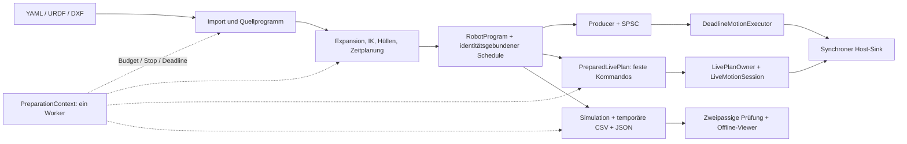
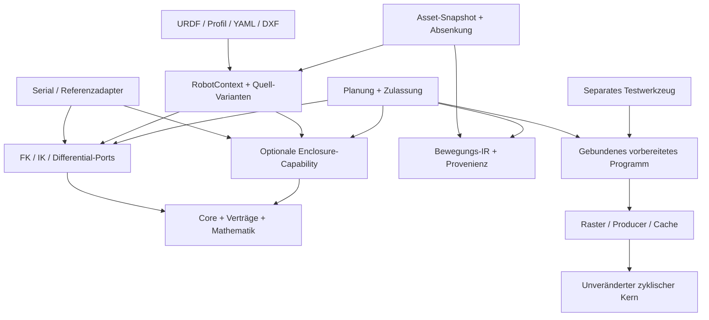

# Architektur-Review Robot Motion C++ 0.16.0

**Stand:** 30.10.2026 (Europe/Berlin). **Untersuchte Basis:**
`5493c3a0d12229372663c73e93c7deec1ce3d79e`, Tag `v0.16.0`, Testwerkzeug 0.5.0.
Vergleich: [Review 0.13.0](architecture_review_v0.13.0.md).

**Abgleich vor Veröffentlichung:** Auf dem Projektbranch lag inzwischen
`1f9077c7445ba48c5db568b0463d2e73e2ba6f90` mit zusätzlichen UTF-8-/CRLF- und
Visual-Asset-Änderungen. Der Diff von sieben Dateien wurde geprüft: Die fünf
reproduzierten Fehlerpfade bleiben unverändert; im Viewer wurde nur der spätere
Template-/Script-Leseweg angepasst. Die sieben Visual-Asset-Tests dieses neueren
Stands wurden zusätzlich erfolgreich ausgeführt, mit dem vorhandenen nativen
0.16.0-Exporter. Die vollständigen numerischen/CI-Nachweise und Bewertungen haben
weiterhin die oben genannte exakte Basis; eine neue Gesamtbuildmatrix für den
Nachtrag wird nicht behauptet. Die Änderungen des Projektbranches wurden erhalten.

**Arbeitsweise:** Architektur und aktuelle Implementierung über alle Aufgabenbereiche
untersucht, Änderungen der Pakete 1–4 geprüft, kritische Erweiterungs-/Fehlerpfade
mit separaten Prüfprogrammen reproduziert. Quellcode, CMake, produktive Tests und
Werkzeugimplementierung wurden während dieses Reviews nicht verändert. Neue
Prüfprogramme und Builds lagen unter `/tmp/motion-review-v0.16.0/`; dieser Bericht
und seine Nachweise sind reine Dokumentation. Bestehende lokale Builds wurden
für Regressionstests verwendet; kein neuer vollständiger Clean-Build lokal.
Numerische Verfahren wurden stichprobenartig auf Verträge und Zusammenspiel geprüft,
nicht Zeile für Zeile formal verifiziert. Drittbibliotheken wurden nicht intern auditiert.

**Kennzeichnung:** R = in diesem Review reproduziert, B = unmittelbar im aktuellen
Code belegt, A = begründete Risikoeinschätzung, O = offene Anforderung.
P1 = vor Nutzung des betroffenen Erweiterungspfads beheben; P2 = wichtige Korrektur
oder Strukturmaßnahme; P3 = optionale Optimierung. Ein neu gefundener Befund ist
nicht automatisch eine neu eingeführte Regression.

## A. Executive Summary

Die Architektur hat sich seit 0.13.0 deutlich verbessert. Die Modulzyklen sind
aufgelöst, 17 CMake-Komponenten sind getrennt nutzbar, Programm und Schedule werden
identitätsgeprüft, Live-Pläne haben einen verwalteten Besitzer und bestätigten
Shutdown. Der neue Vorbereitungskontext verbindet Budget/Abbruch über viele
Phasen; die Visualisierung hält keine vollständigen numerischen Spurkopien mehr.
Diese Änderungen sind technisch nachvollziehbar und durch Tests gestützt.

Die wichtigsten Grenzen liegen jetzt an **komponierten Build-Konfigurationen und
verbleibenden Provider-Verträgen**. Trotz 34/34 grünen lokalen Kerntests wurden
zwei relevante Probleme zusätzlich reproduziert:

1. `inverse_differential()` übergibt bei einem fehlerhaften fremden Provider mit
   null Achsen eine leere Matrix an Eigen-SVD: UBSan meldet dabei einen Nullreferenzzugriff.
2. Zwei jeweils korrekt über öffentliche Komponenten eingebundene Bibliotheken
   erzeugen unterschiedliche Definitionen derselben Inline-Funktion. Die
   Linkreihenfolge entscheidet über die Serial-Enclosure-Unterstützung.

Dazu kommen drei enger begrenzte Befunde: ein fehlender Abschlusscheck für
kooperativen Abbruch an der direkten Envelope-API, unzureichend geprüfte
Segment-/Quellortzuordnung importierter Spuren und unbegrenzte Aufräumrückstände
bei dauerhaftem Dateisystemfehler im Editor.

**Empfehlung:** zuerst die Provider- und Build-Verträge korrigieren, dann diese
kleinen Fehlerpfade schließen. Anschließend die bereits offenen Themen
IK-Skalierung, Kinematikfähigkeiten und typisierte Programmrepräsentation angehen.
Keine vollständige Neuentwicklung und kein zusätzliches Anwendungsframework.

Positiv neu bestätigt: Der vollständige GitHub-Workflow des untersuchten Commits
ist mit **21/21 erfolgreichen Jobs** abgeschlossen, einschließlich nativer
ARM64-Ausführung, ThreadSanitizer und drei echten Browserabläufen. Das ersetzt
weiterhin keine Pi-/Antriebsabnahme.

## B. Architekturübersicht

### Komponenten, Schnittstellen und Datenflüsse

| Bereich | Verantwortung und wesentliche Abhängigkeiten |
| --- | --- |
| `core/` | Gelenk-/Geometriewerte, Grenzen, Uhrdomäne, Zustandshilfen, Vorbereitungskontext; aus Kompatibilität weiterhin IKinematics und CartesianGantry |
| `contracts/` | ITrajectory, IJointProgram und IExecutionSchedule; nur niedrige Werte als Abhängigkeit |
| `math/` | Starre Transformationen, Bernstein-Polynome und Ableitungs-Jets |
| `kinematics/` | FK/J/IK, differentielle und Intervallabbildung; Eigen nur in kompilierten numerischen Teilen |
| `planning/` | PTP/LIN/CIRC-Geometrie, Spline-Abbildung, Zeitparametrisierung, Hüllen, Stopps und optionale Ruckig-Generatoren |
| `io/` | URDF/SI-YAML/DXF, Dateizugriff und Formatvalidierung |
| `program/` | YAML-Quelle, CALL/DXF-Absenkung, Gesamtplanung, gebundene Referenz/Raster-Paare und Simulation |
| `execution/` | Zyklusraster, Producer, SPSC, Deadline-Executor, Live-Cache, Postfach und Session/Owner |
| `tracking/`, `calibration/` | Zeit-/Frame-validierte Vorhersage, Historie, Kalibrierfit und Moving-Horizon-Vorbereitung |
| `platform/` | Linux-Monotonuhr, absolutes Warten, Affinität/FIFO/mlock-Einrichtung |
| `tools/motion_viewer/` | Separater nativer Exporter, lokaler Python-Dienst, Editor, Offline-Viewer und vendorte UR-Meshes |



Die Abhängigkeitsprüfung misst **11 Schichten, 17 Komponenten und 56 kanonische
Bibliotheksdateien**. Kein Datei-, Modul- oder CMake-Komponentenzyklus.
**81 öffentliche Header**: 47 Aufgabenheader einschließlich zweier Vertragsfassaden,
34 flache Kompatibilitätsheader. Die drei geprüften Runtime-Einstiege schließen
nur `core`, `contracts` und `execution` ein. Die CMake-Auswahl `execution` kann
zusätzliche Headerziele für Schedule-Adapter einbeziehen; das ist kein behaupteter
minimaler CMake-Graph aus ausschließlich drei Targets.

**Wichtige Grenze:** Ein azyklischer Include-/Targetgraph prüft keine C++-ODR-
Konsistenz zwischen separat übersetzten Verbrauchern. F13 zeigt genau diese Lücke.

### Zustand, Nebenläufigkeit und Fehler

- Ein zyklischer Thread besitzt den Executor. SPSC hat genau einen Producer und
  einen Consumer. Das Postfach hat einen Management- und einen zyklischen Teilnehmer.
- `LivePlanOwner` hält aktive/angebotene `shared_ptr`; der Executor leiht Adressen.
  Rückmeldungen erlauben Freigaben im Managementthread. `Quiescent` bestätigt das
  Ende aller Cachezugriffe; der Host muss vor Zerstörung weiterhin Threads joinen.
- `LiveMotionSession` koppelt Sink-Annahme und Commit, verriegelt Fehler und
  meldet Stopbedarf. Eine Sink-Annahme muss synchron, begrenzt und `noexcept` sein.
  Das ist kein Vertrag für asynchrone Bus-/Drive-Acks.
- `PreparationContext` ist lokal und nicht kopierbar. Ein Worker verändert Zähler;
  andere Threads dürfen nur den zugehörigen Stop anfordern. Fertige Pläne halten
  keinen Kontextzeiger. Es gibt keinen neuen globalen oder threadlokalen Zustand.
- Der Editor serialisiert Aufträge. Ein eigener Lock ordnet Abbruch und
  Veröffentlichung. Ergebnis-URLs sind unveränderlich; GC folgt dem Commit.
- Nicht-RT-Code verwendet Result-Typen und Exceptions; RT meldet feste Fehlercodes.
  Producer-Ursachen bleiben seit 0.14.0 als `exception_ptr` erhalten. Die
  durchgängige Domänendiagnose ist noch nicht einheitlich, siehe F11.

### Zentrale Entscheidungen und Auswirkungen

| Entscheidung | Nutzen | Preis / verbleibende Grenze |
| --- | --- | --- |
| Vorbereitung getrennt von zyklischer Ausgabe | Keine IK/Parser/Heap-Lebenszyklen im geprüften Dispatchpfad | Vorbereitungs- und Hostressourcen separat budgetieren |
| Vollcache plus Ring als zwei Ausgabewege | Planwechsel und alternative gepufferte Ausgabe möglich | Unterschiedliche Speicher-/Lebensdauerverträge; Vollcache bleibt groß |
| Echte Legacy-Sammelbibliothek aus wiederverwendeten OBJECT-Dateien | Kompatibilität ohne doppelte Kompilierung | Mehrere sichtbare Targets/Archive und Featuremakros müssen kohärent bleiben |
| Headeralgorithmen und optionale Featuremakros | Einfacher Quellcodeeinbau und Templates | ODR-Konsistenz ist zusätzlich zur Abhängigkeitsrichtung erforderlich |
| Striktes SI-YAML mit Stillstand an Segmentgrenzen | Klare Einheiten und einfache Übergaben | Eigene Schema-/IR-Pflege; keine kontinuierliche CAD-Bearbeitung ohne Zusatzvertrag |
| Kooperative Budgets mit explizitem Kontext | Phasenübergreifende Zulassung und Abbruch ohne globale Zustände | Kein harter Heap-/RSS-/WCET-Vertrag; alte Überladungen nutzen lokale Limits |
| JSON-v1 mit CSV-Spooling und Zweipassprüfung | Kompatibles Format bei deutlich weniger numerischen Kopien | Eingabestring, Meshes und HTML bleiben materialisiert |

Eigen, yaml-cpp, tinyxml2 und Ruckig sind lokal hashgebunden, KDL ist testseitig.
Python benötigt zur Ausführung nur die Standardbibliothek, Three.js ist vendort;
Playwright ist eine separate Testabhängigkeit. Offline-Build und Tooltrennung sind
Stärken. Eine dokumentierte Aktualisierungs-/Verantwortungspolitik für vendorte
Abhängigkeiten bleibt eine Teamaufgabe, kein Anlass für ein neues Framework.

## C. Qualitätsbewertung

Skala 1–5 wie im ersten Review. Werte sind technische Bewertungen für den
betrachteten Softwarebedarf; keine Hardwarefreigabe. Keine gewichtete Gesamtnote.

| Kriterium | 0.13.0 | 0.16.0 | Begründung am aktuellen Code |
| --- | ---: | ---: | --- |
| Modularität | 3 | 4 | Niedrige Verträge, azyklischer Graph, 17 Targets und unabhängige Consumer; F13 zeigt noch eine Build-Kompositionslücke. |
| Separation of Concerns | 3 | 3 | RT/Vorbereitung/Tools sauber getrennt; `compile_robot_program` kombiniert weiter Assetverwaltung, Expansion, Planung und Rasterung. |
| Kopplung | 2 | 3 | Math/Contracts sind entkoppelt; `enclosure::evaluate` und Spline-Mapping kennen weiter konkrete Kinematiken, RobotProgram besitzt ImportedSerialRobot. |
| Kohäsion | 3 | 3 | Numerische und Ausführungsbausteine sind fachlich zusammenhängend; Core und ProgramInstruction bündeln weiterhin verschiedene Rollen. |
| Erweiterbarkeit | 3 | 3 | Gute Ports für FK/Trajektorie/Schedule; neue Enclosure-Typen und Befehle erfordern zentrale Sonderbehandlung, F04/F05. |
| Wartbarkeit | 3 | 4 | Geprüfte Modulgrenzen, Migrationspfade, neun Klassensichten und explizite Lebensdauer-/Budgetverträge; Makro- und Diagnosevertrag bleibt verbesserungsbedürftig. |
| Testbarkeit | 4 | 4 | KDL, virtuelle Uhren, Fehlerfixtures, Fuzzing, ASan/UBSan/TSan und Browser/ARM in CI; Mixed-TU- und inverse Nullachsenfälle fehlen. |
| Wiederverwendbarkeit | 3 | 4 | Gezielt einbindbare CMake-Komponenten und Legacy-Fassade; Serial-Programmkontext und F13 begrenzen freie Komposition, Install/Export bleibt optional. |
| Robustheit | 2 | 3 | Alte UB-/Identitätsfälle korrigiert, Sessionfehler und Budgets verriegelt; F14 bleibt eine ungeschützte Provider-Grenze, F15/F16 sind weitere Vertragslücken. |
| Performance | 3 | 4 | Keine vollständigen Python-Floatlisten/Unicodekopien, native CSV auf Platte, DXF-Parsecache, reservierte Live-Caches; SVD-/UI-Redundanz und Vollcachekosten bleiben. Kein Pi-WCET. |
| Skalierbarkeit | 3 | 3 | Ressourcensteuerung pro Auftrag verbessert; kein globaler RAM-/Scratch-Etat und kein begrenzter GC-Rückstau bei Dauerfehlern, F17. |
| Verständlichkeit | 4 | 4 | Tutorial, Diagramme und Aufgabenstruktur sind gut; Format-/Planungsinvarianten, optionale Makros und mehrere Fehlerformen benötigen weiterhin Erklärung. |

## D. Architekturprobleme und Altbefunde

### Status des ersten Reviews

| Altbefund | Aktueller Status | Beleg / Rest |
| --- | --- | --- |
| F01 Providerformen | Ursprüngliche Schedule-/Path-/Spline-Fälle behoben; Grenzschutz weiterhin unvollständig | `check_state` vor Kopie, `check_point` vor Indizierung und Negativfixtures; neuer Rest F14 in inverse_differential |
| F02 Referenz/Schedule | Ursprünglicher Fehlermix behoben | `PreparedRobotProgram::validate()` prüft `schedule->references(*reference)` vor Simulation; Legacy-Paar bleibt öffentlich, aber geprüft |
| F03 Modulzyklen | Behoben | Azyklische Schichten-/CMake-Prüfung, echte separate Komponenten; F13 ist eine zusätzliche ODR-Frage |
| F04 konkrete Kinematikkenntnis | Offen | zentrale dynamic_cast-Liste und ImportedSerialRobot im Programm |
| F05 Quell-/Bewegungsrepräsentation | Offen | ProgramInstruction plus Compiler-Fallunterscheidungen; noch keine getrennte typisierte Bewegungs-IR |
| F06 Legacy-Tracking-NaN | Ursprünglicher NaN-/Altersfall behoben | finite-/Policy-Prüfungen im Predictor; damit keine pauschale Gleichheit aller Legacy-/neuen Trackingverträge behauptet |
| F07 IK-Skalierung | Offen | prismatic_scale_m wird weiter nur importiert/validiert |
| F08 Ressourcen | Wesentlich umgesetzt, mit offenen Systemgrenzen | Kontext, DXF-Cache, Spooling/Zweipass; F15/F17 und globale Budgets bleiben |
| F09 Veröffentlichung/GC | Ursprüngliche widersprüchliche Erfolgs-/Fehlermeldung behoben | GC-OSError ändert den Commit nicht mehr; Rückstaugrenze ist separat F17 |
| F10 CI-Nachweise | Softwareseitige Lücke geschlossen | 21 erfolgreiche Remote-Jobs, ARM64 34 Tests, TSan drei Tests, Browser-Smokes; Pi-WCET bleibt Hardwarearbeit |
| F11 Diagnosen/Policies | Teilweise verbessert | Session-/Producer-/Preparation-Diagnosen strukturiert; Planerursachen und Zulassungspolicies weiterhin verteilt |
| F12 optionale Optimierungen | Weiter optional | kein Install/Export-Paket; paint() zeichnet Serien neu; doppelte IK-SVD-Arbeit |

### F14 — Leere inverse Differentialkinematik führt zu UB — P1, R/B

**Stelle:** [inverse_differential.cpp:8](https://github.com/cpr-jar/Robotmotionplanning/blob/5493c3a0d12229372663c73e93c7deec1ce3d79e/src/kinematics/inverse_differential.cpp#L8),
[SVD-Aufbau:24](https://github.com/cpr-jar/Robotmotionplanning/blob/5493c3a0d12229372663c73e93c7deec1ce3d79e/src/kinematics/inverse_differential.cpp#L24).

Die Funktion akzeptiert einen fremden `IDifferentialKinematics` mit `dof()==0`,
leerem q und sechs leeren Jacobizeilen. Die vorhandenen Größenprüfungen bestehen;
anschließend erhält Eigen eine 6×0-Matrix. Der Stacktrace zeigt den ersten UB
bereits in `JacobiSVD::compute()` beim SVD-Aufbau in Zeile 24. Auch der danach
vorgesehene Zugriff auf `singular[0]` wäre nicht gegen eine leere SVD abgesichert.

**Reproduktion:** unveränderte Implementierungsdatei mit ASan/UBSan und NDEBUG
separat übersetzt. Ergebnis: `runtime error: reference binding to null pointer of
type 'const double'`. Das ist kein Result-/Exception-Fehlerpfad.

**Auswirkung:** Ein fehlerhafter Hostadapter kann den Vorbereitungsprozess zum
Absturz bringen. Mitgelieferte Serial-Konstruktoren verbieten null Achsen;
deshalb ist das kein belegter Absturz eines importierten UR5e-Programms.
Architekturursache ist die weiterhin verteilte Validierung fremder Provider.
Die bisherigen F01-Tests decken diese API nicht mit einem Nullachsenprovider ab.

### F13 — Komponentenabhängige Inline-Definitionen verletzen die ODR — P2 hoch, R/B

**Stellen:** [Serial-Makro am Target](https://github.com/cpr-jar/Robotmotionplanning/blob/5493c3a0d12229372663c73e93c7deec1ce3d79e/src/kinematics/CMakeLists.txt#L2),
[enclosure::evaluate():169](https://github.com/cpr-jar/Robotmotionplanning/blob/5493c3a0d12229372663c73e93c7deec1ce3d79e/include/motion/kinematics/interval_kinematics.hpp#L169),
[bedingt unterschiedliches Spline-Mapping:150](https://github.com/cpr-jar/Robotmotionplanning/blob/5493c3a0d12229372663c73e93c7deec1ce3d79e/include/motion/planning/cartesian_spline.hpp#L150).

Ein lokaler Parent bindet einmal das Projekt ein und erstellt zwei statische
Verbraucher: A linkt `RobotMotion::planning`, B `RobotMotion::serial_kinematics`.
CMake gibt nur B `MOTION_WITH_SERIAL=1`. Beide übersetzen denselben öffentlichen
Header, dessen externe Inline-Funktion dadurch unterschiedliche Definitionen hat.
Das verletzt die One Definition Rule; ein korrekter Targetgraph verhindert das nicht.

**Reproduktion mit identischen Objekten, GCC Debug -O0/-fno-inline:**

```text
A vor B: gantry=1, serial=Serial enclosure support disabled in this build
B vor A: gantry=1, serial=ready: 0.100000
```

**Auswirkung:** In einem regulär komponierten Consumer kann eine unterstützte
Kinematik abhängig von Linkreihenfolge/Optimierung abgelehnt werden. Die Reproduktion
belegt keine falsche physische Bahn und keinen Fehler der einheitlich konfigurierten
Legacy-Beispiele. Eine solche ODR-Verletzung darf dennoch kein Buildvertrag sein.
Die vorhandene Serial+Planning-Fixture hat nur eine Translation Unit und findet
diesen Fall nicht. Der bedingte Mechanismus bestand bereits früher; hier wird
seine Konsequenz bei der nun vorgesehenen Komponentenkomposition neu nachgewiesen.

### F15 — Direkte Envelope-API prüft Abbruch nach letztem Callback nicht — P2, R/B

**Stelle:** [envelope_constraints.hpp:43](https://github.com/cpr-jar/Robotmotionplanning/blob/5493c3a0d12229372663c73e93c7deec1ce3d79e/include/motion/planning/envelope_constraints.hpp#L43)
und [Rückgabe:84](https://github.com/cpr-jar/Robotmotionplanning/blob/5493c3a0d12229372663c73e93c7deec1ce3d79e/include/motion/planning/envelope_constraints.hpp#L84).

Der Kontext wird am Intervallanfang geprüft. Fordert das letzte benutzerdefinierte
`IEnvelopeConstraint::admit()` einen Stop an und liefert true, gibt
`check_polynomial_constraints(..., options.preparation)` trotzdem Erfolg zurück.
Reproduziert: `stop_requested=1, admitted=1, context_failure=0`.

**Auswirkung:** Der direkte öffentliche Kontextvertrag unterscheidet sich vom
abschlussgeprüften Live-Cache und kann einen bereits angeforderten Abbruch nach
dem Callback übersehen. Im aktuellen Gesamtcompiler folgt die Rasterung mit
weiterem Checkpoint; hier wurde **keine Veröffentlichung eines abgebrochenen
Gesamtprogramms** nachgewiesen. Es geht um den direkt verwendeten API-Baustein.
Kooperativer Abbruch bleibt auch nach Korrektur keine atomare Präemption.

### F16 — Importierte Spuren sind nicht mit Segment-/Quellmetadaten abgeglichen — P2, R/B

**Stelle:** [create_viewer.py:208](https://github.com/cpr-jar/Robotmotionplanning/blob/5493c3a0d12229372663c73e93c7deec1ce3d79e/tools/motion_viewer/create_viewer.py#L208),
[Grenzpunktauswahl:252](https://github.com/cpr-jar/Robotmotionplanning/blob/5493c3a0d12229372663c73e93c7deec1ce3d79e/tools/motion_viewer/create_viewer.py#L252).

Die Spurprüfung validiert Ticks, Zeiten, Grenzen und endliche Werte, aber nur den
Zahlenbereich von segment und Positivität von source_step. Ein unveränderter
Fünfsegment-UR5e-Export wurde ausschließlich in diesen beiden CSV-Spalten geändert:
alle Zeilen segment=1, source_step=999. `prepare_data()` akzeptiert ihn ohne
Grenzverletzung; die Anzeigepunkte weisen nur noch Segment 1/Schritt 999 aus.

**Auswirkung:** `--from-export` kann widersprüchliche Test-/Diagnosedaten als gültige
Ansicht darstellen; tatsächliche Segmentwechsel sind keine Pflichtpunkte mehr.
Der native Exporter erzeugt diese Manipulation nicht. Es ist ein Fehler an der
öffentlichen Austausch-/Validierungsgrenze, kein nachgewiesener Motion-Planungsfehler.
Die Architektur hat hier zwei Wahrheiten — Segmentmetadaten und CSV — ohne
vollständige gemeinsame Zuordnungsinvariante.

### F17 — Aufräumfehler haben keinen begrenzten Scratch-Rückstau — P2, R/B/A

**Stellen:** [GC:132](https://github.com/cpr-jar/Robotmotionplanning/blob/5493c3a0d12229372663c73e93c7deec1ce3d79e/tools/motion_viewer/editor_server.py#L132)
und [Commit/Ablauf:278](https://github.com/cpr-jar/Robotmotionplanning/blob/5493c3a0d12229372663c73e93c7deec1ce3d79e/tools/motion_viewer/editor_server.py#L278).

Die Trennung von Commit und GC ist richtig. Bei dauerhaftem `rmtree`-OSError
werden alte Ordner jedoch weiter in `_expired_results` gesammelt und neue
Aufträge unbegrenzt angenommen. Sechs erfolgreiche kurze Simulationen mit
injiziertem Dauerfehler: drei veröffentlichte Ergebnisse, drei GC-Rückstände,
sechs Ergebnisverzeichnisse. Der Code hat keine Obergrenze für diesen Rückstau.

**Auswirkung:** Ergebnisanzahl 3 begrenzt nicht den Plattenverbrauch unter Fehlern;
mit weiteren Läufen wachsen Scratch und GC-Arbeit. Ein erschöpftes Laufwerk wurde
nicht absichtlich herbeigeführt. Das ist ein Rest von F08, keine erneute Behauptung
des behobenen F09-Fehlers „Erfolg wird nachträglich zu 422“.

### Weitere offene Strukturthemen

**F04 / P2, B:** `enclosure::evaluate()` kennt Gantry, SCARA, Delta und Serial;
[RobotProgram:116](https://github.com/cpr-jar/Robotmotionplanning/blob/5493c3a0d12229372663c73e93c7deec1ce3d79e/include/motion/program/robot_program.hpp#L116)
besitzt ein Importergebnis. Austauschbare Fähigkeiten enden damit an zentraler
Typkenntnis. Unbekannte Enclosures sicher abzulehnen ist korrekt. Für weitere
URDF-Serialmodelle ist deshalb noch kein neues Pluginframework nötig; der Nutzen
eines Ports entsteht bei zusätzlichen Kinematikfamilien und löst zugleich F13.

**F05 / P2, B/A:** [ProgramInstruction:35](https://github.com/cpr-jar/Robotmotionplanning/blob/5493c3a0d12229372663c73e93c7deec1ce3d79e/include/motion/program/robot_program.hpp#L35)
mischt Quell-DXF, WAIT-/Kreisfelder, Targets und abgesenkte CAD-Provenienz.
[compile_robot_program:76](https://github.com/cpr-jar/Robotmotionplanning/blob/5493c3a0d12229372663c73e93c7deec1ce3d79e/src/program/program_planning.cpp#L76)
plant, verwaltet Assets/Parsecache und rastert. Das ist keine belegte globale
God Class; es ist ein konkreter Änderungsbrennpunkt für neue Befehle.

**F07 / P2, B:** `prismatic_scale_m` steht in öffentlichen Optionen, Profilimport
und Validierung. Die Suche in `include/` und `src/` findet keine Verwendung im
Solver. Der [Schritt:201](https://github.com/cpr-jar/Robotmotionplanning/blob/5493c3a0d12229372663c73e93c7deec1ce3d79e/src/kinematics/serial_chain_kinematics.cpp#L201)
benutzt die rohe Delta-Norm; nur die Orientierungszeilen werden skaliert.
Der Konfigurationsregler bleibt wirkungslos. Auswirkungen auf gemischte reale
Roboter wurden hier nicht vermessen.

**F08 / P2, B/O:** Budgets sind jetzt kumulativ und sinnvoll dokumentiert. Ein
Kontext ist aber ausdrücklich kein globaler RAM-Pool. DXF-Cachebytes werden nach
einem Parse zugelassen, Parser-/Solver-Scratch und mehrere Kontexte sind nicht
vollständig erfasst. Alte Überladungen wählen nullptr; das erhält Kompatibilität,
verlangt bewusste Hostintegration. Keine dieser offen benannten Grenzen wird hier
als zugesagte harte RSS-/Zeitgarantie umgedeutet.

**F11 / P2, B:** Neue PreparationError-Phasen helfen, doch [Compiler:203](https://github.com/cpr-jar/Robotmotionplanning/blob/5493c3a0d12229372663c73e93c7deec1ce3d79e/src/program/program_planning.cpp#L203)
übernimmt andere Ursachen meist als Text in RobotProgramError. Spline-/Envelope-
Status und fachliche Zulassungspolicies bleiben teilweise zusammengefasst oder
als Konstanten verteilt. Benannte Richtlinien und stabile Ursachecodes sind vor
der konkreten Steuerungsdiagnostik hilfreicher als ein neues Exceptionframework.

**F12 / P3, B/A:** Install/Export erst bei tatsächlichem Paketbedarf; `paint()`
erstellt Serien und Charts pro Frame neu; IK berechnet vor dem Schritt bereits
Singularität und danach nochmals Jacobimatrix/SVD. Optimierung nach Profiling.
Dateilänge allein ist kein Architekturdefekt. Keine neue zentrale Registry,
keine pauschale Header-Verlagerung und kein neues Webframework empfohlen.

## E. Priorisierte Verbesserungsvorschläge

Aufwand in groben Personentagen inklusive gezielter Regressionstests; etwa ±50 %,
keine Terminzusage. Ein Teil der Maßnahmen ist kombinierbar.

| Priorität / ID | Sollzustand und konkrete Umsetzung | Nutzen / Aufwand |
| --- | --- | --- |
| P1 / F14 | Dof-Bereich vor Eigen-Aufbau validieren, leeren SVD-Fall defensiv ablehnen; weitere inverse Providerformen/Endlichkeiten als negative Vertragstests ergänzen. | Kein UB durch Nullachsenadapter; 0,5–1 PT |
| P2 hoch / F13 | Identische Definitionen pro C++-Entität sicherstellen. Kurzfristig einheitliche Featurekonfiguration aller TUs einer Anwendung verbindlich machen; Mixed-TU-Regression in beiden Linkreihenfolgen. Ziel: Serial-Capability/Adapter statt makroabhängiger generischer Inline-Bodies. Nur den Final-Executable-Link zu ändern genügt nicht für bereits übersetzte Bibliotheken. | Verlässliche Komponentenkomposition; 1–3 PT kurzfristig, mit F04 weiterführen |
| P2 / F15 | Vor erfolgreicher Envelope-Rückgabe erneut checkpoint(); unmittelbaren Callback-Stop und abgelaufene Callback-Deadline gezielt prüfen. API-Vertrag über Kontext-Entry/Exit vereinheitlichen. | Einheitlicher kooperativer Abbruch; 0,5 PT |
| P2 / F16 | Segment aus Raster/Metadaten bestimmen oder CSV-Zuordnung exakt dagegen prüfen, einschließlich Source-Step und Grenzkonvention. Validator in beiden Durchläufen konsistent verwenden. | Verlässliche importierte Diagnoseansicht; 0,5–1,5 PT |
| P2 / F17 | Scratch-/GC-Rückstau nach Bytes/Anzahl begrenzen. Vor neuen Aufträgen Cleanup versuchen; bei erreichtem Etat Admission stoppen, bisherige Resultate behalten und eine eigene Ressourcendiagnose melden. GC darf weiter keinen Commit zurückrollen. | Begrenztes Wachstum im Fehlerfall; 0,5–1,5 PT |
| P2 / F07 | Gelenkskalierung einschließlich Jacobispalten und Rücktransformation umsetzen oder die wirkungslose Option ausdrücklich deaktivieren/deprecatieren. Gemischte rotatorische/prismatische Metamorphiktests. | Konfiguration mit definierter Wirkung; 1–3 PT |
| P2 / F04 | Kleiner RobotContext mit benötigten Kinematik-/Enclosure-Fähigkeiten, getrennt vom Dateiimport. Vorhandene Serial-/Referenzadapter weiterverwenden, keine dynamische Registrierung ohne Bedarf. | Neue Kinematikfamilien und Lösung für F13; 3–5 PT |
| P2 / F05 | Getrennte Varianten für Quellbefehle und abgesenkte Bewegungen; Asset-Snapshot/Expansion vor den Motion-Compiler ziehen. YAML v1/Quellorte/Stops erhalten. | Kleinerer Änderungsradius neuer Befehle; 3–6 PT |
| P2 / F08/F11 | Hostprofil für aktive/angebotene Pläne, Parser-Scratch, Jobs und maximale Abbruchwartezeit festlegen; benannte Admission-Policies und durchgehende Nicht-RT-Ursachecodes ergänzen. | Planbare Integration/Diagnose; 1–3 PT Software, Zielplattformmessung separat |
| P3 / F12 | UI-/SVD-Profiling, danach nur gemessene Wiederholungsarbeit reduzieren; Install/Export erst bei echtem Verteilungsbedarf. | Optionaler Komfort-/Ressourcennutzen; einzeln 0,5–3 PT |

## F. Zielarchitektur und Migrationskosten

Die vorhandene Schichtung bleibt. Geändert werden ausgewählte Grenzen, nicht die
Bewegungsgesetze oder der zyklische Kern.



| Heute | Ziel / Kompatibilitätsweg |
| --- | --- |
| Makroabhängige generische Inline-Definition | Generischer Algorithmus mit stabilem Body; auswählbare Fähigkeit in Adapter/Context |
| RobotProgram besitzt ImportedSerialRobot | Importer erzeugt RobotContext; alte Factory-/Accessor-Pfade über Adapter erhalten |
| ProgramInstruction enthält Quelle und Absenkung | Quell-Variant → explizite Absenkung → Bewegungs-Variant, Provenienz als gemeinsamer Wert |
| Einzelne Domänenfehler werden zu Text | Vorhandene Result-/Exceptionformen beibehalten, stabile Ursache/Phase im Nicht-RT-Teil ergänzen |
| Pro-Job-Etat, Fehler-GC ohne Rückstaugrenze | Pro-Job-Etat plus klarer Host-/Scratch-Admission-Vertrag |

**Migrationskosten:** Öffentliche Header/Factories nicht abrupt entfernen. Neue
Overloads/Adapter ergänzen, bestehende Beispiele und beide Ausgabewege parallel
prüfen. Kleine Korrekturen F14–F17 sind weitgehend unabhängig. F13/F04 hängen
zusammen und sollten gemeinsam entworfen werden; eine vorschnelle allgemeine
Pluginplattform würde mehr Kosten als Nutzen verursachen. F05 erst nach stabilen
Capability-/Fehlerverträgen oder vor dem nächsten größeren Befehlspaket.

**Erweiterungspunkte:** neue Befehle ändern primär Quelle/Absenkung; neue
Kinematikfamilien liefern Ports/Fähigkeiten; Hostadapter implementieren weiterhin
den synchronen Sink. Die Produktion benötigt weder Editor noch Python.

## G. Schrittweiser Migrations- und Prüfplan

1. **Provider-Korrektur F14:** kleine isolierte Änderung. Gate: Nullachsenprovider
   liefert Fehlerresultat, kein UBSan-/ASan-Befund; bestehende FK/J/KDL-Tests grün.
2. **Kompositionsvertrag F13:** Mixed-TU-Test dauerhaft aufnehmen, beide
   Linkreihenfolgen und Debug/Release prüfen. Gate: gleiche Zulassungen und
   Ergebnisse bei weiterhin getrennt verwendbaren Planning-/Serial-Targets.
3. **Begrenzte Vertragskorrekturen F15–F17:** je eigener, überprüfbarer Schritt.
   Gates: Stop im letzten Callback wird beachtet; falsche Segment-/Schrittzuordnung
   abgelehnt; dauerhafter Cleanupfehler erreicht einen dokumentierten Etat und
   stoppt neue Admission, ohne vorhandene Erfolgsresultate umzudeuten.
4. **IK-Konfiguration F07:** Invarianz-/Wirkungstests für gemischte Einheiten vor
   Implementierung festlegen. Reine Rotationsmodelle gegen aktuelle Referenzen
   prüfen; numerische Unterschiede begründen statt nur Snapshots aktualisieren.
5. **Bedarfsgerechte Struktur F04/F05/F11:** erst RobotContext/Capabilities, dann
   Quelle/Absenkung und Diagnosen. Gate: YAML-v1-/DXF-Kompatibilität, Quellorte,
   Endzustände und konservative Limits erhalten; zusätzliches Toy-Modell benötigt
   keine zentrale Typ-Sonderbehandlung.
6. **Anlagenprofil und Plattformabnahme:** RAM/Scratch, gleichzeitige Pläne und
   Abbruchlatenz festlegen, danach Pi-Lastmessungen über 1–20 ms. ARM64-CI weiter
   nutzen, aber nicht als Pi-WCET ersetzen. CANopen bleibt zurückgestellt.

Jeder Schritt erhält die passenden Negativverträge zusätzlich zur Beispielsuite.
Vorhandene Release-/Sanitizer-/KDL-/Fuzz-/Browser-/ARM-/TSan-Jobs weiterführen.
Keine vollständige Neuentwicklung, keine pauschale Änderung aller Header und
keine gleichzeitige Umstellung von Format, Numerik und Laufzeitausgabe.

### Tatsächlich ausgeführte bzw. beobachtete Prüfungen

| Nachweis | Ergebnis / Abgrenzung |
| --- | --- |
| Lokal erneut: bestehender Release-Build | 34/34 CTests, 20,45 s; kein Clean-Build |
| Lokal erneut: fokussiertes ASan/UBSan | 6/6: Provider, Programm, Vorbereitung, Session und Allokationen |
| Lokal erneut: fokussiertes Clang-19-TSan | 3/3: Vorbereitung, Session und Ausführungsfehler |
| Lokal erneut: Architektur | 11 Schichten/17 Komponenten/56 Dateien, drei reine Runtime-Abschlüsse; sechs Guard-Fixtures |
| Neue Review-Probes | F13 zwei frisch gebaute Verbraucher/Linkreihenfolgen; F14 separat instrumentierte unveränderte CPP; F15 letzter Constraint-Callback; F16 verfälschte Metadaten; F17 dauerhafter GC-OSError |
| GitHub-Run 41037626654 | 21/21 Jobs erfolgreich; untersuchter Commit exakt 5493c3a |
| Remote ARM64-Log | GNU 13.3.0, nativer ubuntu-24.04-arm-Runner, 34/34 CTests |
| Remote TSan-Log | Clang 18.1.3, 3/3 CTests |
| Remote Viewer-Log | Werkzeug-CTest plus drei erfolgreiche Chromium-Smokes einschließlich Abbruch und DXF |
| Bereits gespeicherte 0.16.0-Evidenz | Volles ASan 34/34, 38 Python-Tests, 47 Header, sechs bytegleiche Bewegungsexporte; im Review nicht pauschal als neu ausgeführt bezeichnet |

[Remote-Workflow](https://github.com/cpr-jar/Robotmotionplanning/actions/runs/41037626654),
[ARM64-Job](https://github.com/cpr-jar/Robotmotionplanning/actions/runs/41037626654/job/124002267425),
[Nachweise und reproduzierbare Prüfprogramme](../testing/evidence/review_v0.16.0/README.md).
Keine vollständige neue Fuzzkampagne, kein neues Audit aller Drittquellen, keine
physische Hardware-/Stop-/Busprüfung und keine formale Intervallzertifizierung.

## H. Offene Anforderungen und Entscheidungen

1. Welche Obergrenzen gelten für Programm-/CAD-Komplexität, Gesamt-RAM,
   Platten-Scratch, aktive/angebotene Pläne und parallele Vorbereitungsaufträge?
   Der aktuelle Kontext liefert Nutzdaten-/Arbeitszähler, keinen Prozessetat.
2. Wie lang darf ein Abbruch maximal warten, insbesondere bei Dateisystem,
   Drittparsern oder fremden Kinematik-/Loaderaufrufen? Reicht kooperativer Abbruch
   oder benötigt der Host einen getrennten Workerprozess?
3. Braucht die eigene Steuerung weitere Kinematikfamilien oder zunächst nur
   zusätzliche serielle URDF-Modelle? Davon hängt der Termin für F04 ab.
4. Kommen neue Befehle, IO/WAIT-Bedingungen oder Hersteller-/G-Code-Importer als
   Nächstes? Das bestimmt den Nutzen und Zeitpunkt von F05.
5. Welche Modell-/Kalibrierrevision muss beim Planwechsel identisch sein?
   LivePlanStamp prüft derzeit Generation, Vorgänger, Uhr, Raster und Grenzwerte,
   aber keine allgemeine Modell-/Kalibrieridentität. Die Anlagenpolicy ist offen.
6. Genügt Quellcodeeinbau mit add_subdirectory oder werden installierte Pakete,
   gemeinsame Bibliotheken und ein ABI-Versprechen benötigt? Aktuell besteht kein
   solcher zugesagter Distributions-/ABI-Vertrag.
7. Pi 4B, selbst entwickelte Steuerung und 1–20 ms sind bekannt. CANopen bleibt
   auf Wunsch zurückgestellt; konkrete Achsannahme, Stopreaktion und physische
   Timingabnahme werden erst bei der späteren Integration festgelegt.
