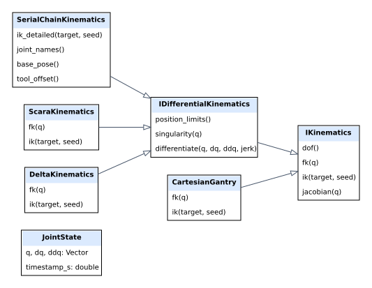
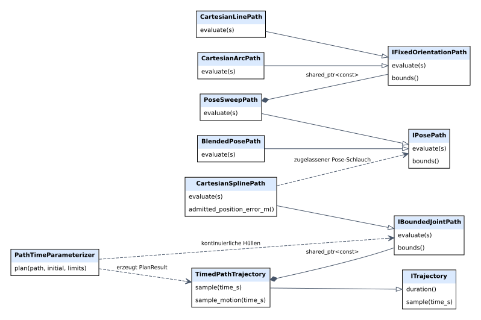
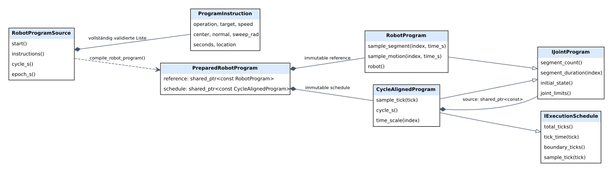
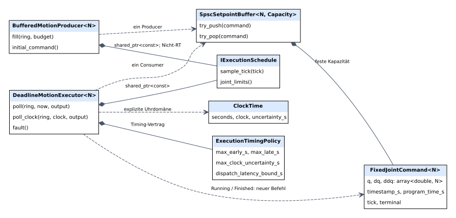
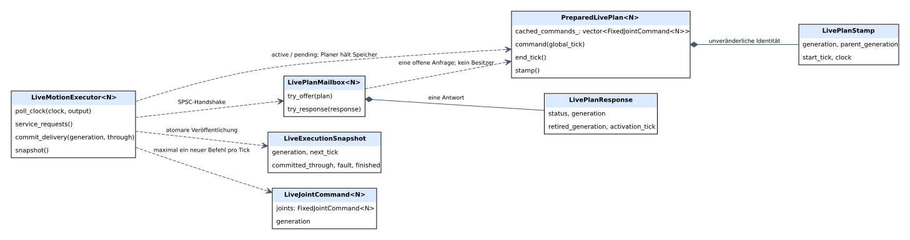
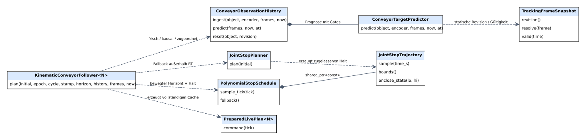
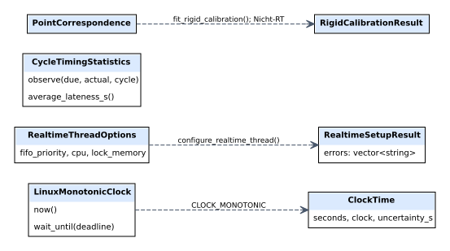

# UML-Klassendiagramme

Die folgenden sieben Sichten beschreiben vorhandene Typen. Eine leere
Dreieckspitze bezeichnet Vererbung; eine ausgefüllte Raute den Besitzer der
enthaltenen Werte oder `shared_ptr`. Gestrichelte Pfeile zeigen Nutzung bzw.
geliehene Referenzen. Geteiltes Eigentum ist zusätzlich beschriftet.
Funktionen, die Objekte erzeugen, stehen an den Pfeilen; ausgewählte Methoden
sind verkürzt dargestellt. Vollständige Signaturen stehen in den Headern.

## 1. Kinematik und Zustände

`CartesianGantry` implementiert das Basisinterface; serielle, SCARA- und Delta-
Kinematik implementieren zusätzlich das differentielle Interface. Der lokale
serielle IK-Solver garantiert keine globale Verzweigungssuche.
[DOT-Quelle](diagrams/kinematics.dot).

## 2. Geometrie, Abbildung und Zeitplanung

Geometrieparameter s ist keine Zeit. Die Spline-Abbildung verbindet Posepfad und
Kinematik; erst danach bestimmt die Zeitplanung einen zulässigen Verlauf.
Die Pfeile zur Referenzgeometrie beschreiben die Zulassung, nicht zwingend eine
zusätzliche gespeicherte Laufzeitreferenz. [DOT-Quelle](diagrams/planning.dot).

## 3. Anwenderprogramm und Schedule

Ein vollständig zugelassenes `PreparedRobotProgram` enthält sowohl die fachliche
Programmreferenz als auch das Zyklusraster. Der Schedule verlängert Segmente mit
ruhenden Grenzen auf volle Ticks. [DOT-Quelle](diagrams/program.dot).

## 4. Gepufferte Ausführung

Nur ein Producer und ein Consumer dürfen denselben SPSC-Puffer bedienen.
`fill()` sampelt außerhalb RT; `poll_clock()` liest feste Befehle und prüft die
Zeit vor der Veröffentlichung. [DOT-Quelle](diagrams/buffered_execution.dot).

## 5. Cache und Live-Planwechsel

Der Planer bzw. die Host-Anwendung besitzt die Caches. Postfach und Executor
leihen deren Adressen. Die Rückmeldung identifiziert abgelehnte bzw. nicht mehr
benutzte Generationen; die Freigabe erfolgt außerhalb des zyklischen Threads.
[DOT-Quelle](diagrams/live_execution.dot).

## 6. Optionales Following und vorbereiteter Halt

Neue Horizonte und ihr Stillstands-Fallback werden vollständig außerhalb des
zyklischen Threads erzeugt. Fallen Beobachtungen aus, bleibt der bereits
zugelassene Halt verfügbar. Für diese Sicht ist `MOTION_WITH_RUCKIG=ON` nötig.
[DOT-Quelle](diagrams/tracking_stops.dot).

## 7. Linux-Zeitplattform und Kalibrierung

Thread-Setup und Kalibrierungs-Fit sind Vorbereitungsarbeiten. Die
`LinuxMonotonicClock` ist optional; eure Steuerung kann stattdessen eine eigene
Uhr mit `ClockTime now() noexcept` bereitstellen.
[DOT-Quelle](diagrams/platform_calibration.dot).

Weitere Abläufe: [Sequenzen und Zustände](runtime_flows.md).
Die Quellen können mit [render_diagrams.py](../../tools/architecture/render_diagrams.py)
erneut als SVG oder PDF erzeugt werden. Alle SVGs sind ohne Renderer lesbar.
