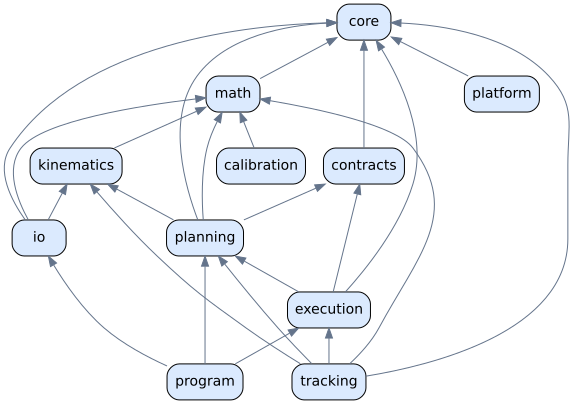

# Modulgrenzen und CMake-Komponenten — 0.15.0

Dieses Paket behebt **F03** des [Reviews für 0.13.0](architecture_review_v0.13.0.md):
gemeinsame Verträge liegen unterhalb ihrer Verbraucher; Mathematik importiert
keine Kinematikheader und Kinematik keine Planungsheader mehr. Kompilierte Solver, Import,
Kalibrierung und Programmverarbeitung sind einzeln wählbar. Es werden weder
Bewegungsgesetze noch Programmformate geändert.

## Gemessene Abhängigkeiten



Die Pfeile zeigen vom Verbraucher zum Anbieter. Das Diagramm wird aus den
tatsächlichen Includes von öffentlichen Headern und Bibliotheksquellen erzeugt.
Auch bedingte Includes werden gezählt. Es gibt **keine Datei-, Modul- oder
CMake-Komponentenzyklen**. Die Schichtregeln stehen in [layers.json](layers.json)
und werden in CI geprüft; sie sind keine bloße Zeichnung einer Zielarchitektur.

| Bisherige Kopplung | Neue Zuständigkeit |
| --- | --- |
| Ausführung importiert `program/joint_program.hpp`; Programme importieren Ausführung | `contracts/joint_program.hpp` und `contracts/trajectory.hpp` enthalten die unveränderten gemeinsamen Schnittstellen |
| Schedule-Vertrag importiert konkrete Gelenkplaner | `contracts/execution_schedule.hpp`; gemeinsame Stillstandsprüfung in `core/joint_state_checks.hpp` |
| Matrixjets importieren Differentialkinematik | `math/derivative_jets.hpp` benötigt nur geometrische Grundwerte und Standardmathematik |
| Intervallkinematik importiert den vollständigen Quintikplaner | `math/bernstein_polynomial.hpp` enthält die unveränderten Bernstein-Operationen |
| Geometrie-/Quaternionhilfen sind an Kinematikinterfaces gekoppelt | `math/rigid_transform.hpp`; Pose, Twist und Ableitungswerte in `core/geometry_types.hpp` |
| DXF-Import zieht kartesische Planung ein | Öffentliches DXF-Datenmodell benutzt nur Grundgeometrie; Implementierung verwendet Mathematikhilfen |
| Ein gemeinsames Serial-Archiv kompiliert sämtliche Aufgaben | Getrennte Objekt-/statische Bibliotheken; ein kompatibles Sammelarchiv bleibt erhalten |

Die öffentlichen C++-Namen bleiben im Namespace `motion`. Mathematische
Ausdrücke, Typfelder, virtuelle Signaturen und Enumwerte wurden nicht umgestaltet.
`core/motion_types.hpp` enthält weiterhin die bisherigen grundlegenden
Kinematikdeklarationen einschließlich Gantry. Ein neues RobotContext-/Enclosure-
Pluginmodell gehört zu F04 und wird hier nicht vorgetäuscht.

## Komponenten wählen

### Bestehende Anwendung unverändert weiterbauen

Ohne `MOTION_COMPONENTS` gilt die bisherige Auswahl:

```sh
cmake -S . -B build -DCMAKE_BUILD_TYPE=Release -DMOTION_WITH_SERIAL=ON
cmake --build build --parallel 2
ctest --test-dir build --output-on-failure
```

`MOTION_WITH_SERIAL=ON` wählt das bisherige vollständige Serial-Paket aus.
`MOTION_WITH_RUCKIG` bleibt eine zusätzliche Legacy-Option. Die bestehenden
Targets `robot_motion`, `RobotMotion::motion`, `robot_motion_serial` und
`RobotMotion::serial` bleiben in dieser Konfiguration nutzbar. Das letzte ist
weiterhin ein **echtes statisches Archiv mit allen zehn bisherigen
Implementierungsobjekten**. Komponentenarchive und Sammelarchiv verwenden
dieselben OBJECT-Targets; die Implementierungen werden dafür nicht doppelt kompiliert.

### Eigene Steuerung nur mit Ausführung einbinden

```cmake
set(MOTION_BUILD_TESTS OFF)
set(MOTION_BUILD_EXAMPLES OFF)
set(MOTION_COMPONENTS execution)
add_subdirectory(external/robot-motion-cpp)
target_link_libraries(my_controller PRIVATE RobotMotion::execution)
```

Oder nur die Komponenten konfigurieren:

```sh
cmake -S . -B build-execution -DMOTION_COMPONENTS=execution \
  -DMOTION_BUILD_TESTS=OFF -DMOTION_BUILD_EXAMPLES=OFF
```

Diese Auswahl benötigt keinen Eigen-, YAML-, XML- oder Ruckig-Download und
keine kompilierte Motion-Bibliothek. Die Runtime wird aus Headern im eigenen
Controller übersetzt. `LiveMotionSession`, `DeadlineMotionExecutor` und
`SpscSetpointBuffer` ziehen transitiv ausschließlich **core, contracts und
execution** ein. Sie importieren keine Planer, seriellen Solver oder Parser.

Das CMake-Ziel `execution` kennt zusätzlich die headerbasierten Planungsziele,
weil andere Header im selben Aufgabenbereich Schedule-Adapter für Quintiken
und Stopps bereitstellen. Diese Beziehung aktiviert keinen kompilierten Solver.
Der reine Runtime-Includeabschluss wird zusätzlich und getrennt davon geprüft.

### Planung und einen seriellen Solver kombinieren

```cmake
set(MOTION_COMPONENTS planning serial_kinematics)
add_subdirectory(external/robot-motion-cpp)
target_link_libraries(my_planner PRIVATE
  RobotMotion::planning RobotMotion::serial_kinematics)
```

Damit wird genau die serielle Implementierung mit Eigen gebaut; kein
Modell-/Programmparser und keine Kalibrierung. Wer URDF/YAML lesen will,
wählt zusätzlich bzw. stattdessen `model_import`. `program` bringt dessen
notwendige Abhängigkeiten automatisch mit.

## Zielübersicht

Alle Namen haben das Präfix `RobotMotion::`. Es existieren nur die ausgewählten
Ziele und ihre Abhängigkeiten. `RobotMotion::motion` ist die Fassade über die
gewählten Wurzelkomponenten, kein unabhängiger zweiter Konfigurationsmechanismus.

| Name | Inhalt | Zusätzliche kompilierte Abhängigkeiten |
| --- | --- | --- |
| `core` | Grundwerte, Grenzen, Uhr, Zustandshilfen, C++20-/Sanitizervertrag | Keine |
| `contracts` | Trajektorien-, Planer-, Programm- und Scheduleinterfaces | Keine |
| `math` | Bernstein, Jets, Vektoren, Quaternionen und Transformationen | Keine |
| `kinematics` | Interfaces und headerbasierte Referenzkinematiken | Keine; serielle Implementierung separat |
| `planning` | Gelenk-/Pose-/Splineplanung und Hüllen | Keine; konkrete serielle Modelle separat |
| `execution` | Raster, Buffer, Dispatcher, Live-Cache und Session | Keine; optionale Stoppadapter brauchen `ruckig` |
| `tracking` | Frames, Beobachtungen und Vorhersage | Keine; vollständiges Following separat |
| `platform` | Linux-Uhr und explizites RT-Setup | Keine |
| `serial_kinematics` | Serielle FK/J/IK/Ableitungen | Eigen-Header, keine Parser |
| `differential_kinematics` | Generische inverse Differentialrechnung | Eigen-Header, keine Serial-/Parserimplementierung |
| `calibration` | Gewichteter starrer Punktfit | Eigen-Header |
| `dxf_import` | Begrenzter Text-DXF-Import und Datenmodell | Keine Drittbibliothek |
| `model_import` | URDF plus SI-YAML-Profil | `serial_kinematics`, yaml-cpp, tinyxml2 |
| `program` | Programmparser, Planung, Retiming, Simulation | `model_import`, `dxf_import`, yaml-cpp |
| `ruckig` | Optionaler Generator-/Stoppadapter | Lokales Ruckig |
| `following` | Beobachtungshistorie und generisches/XYZ-Following mit vorbereitetem Halt | `ruckig`, `differential_kinematics`; Serial nur bei Bedarf zusätzlich |
| `serial` | Kompatibles vollständiges Serial-Sammelarchiv | Alle bisherigen kompilierten Teile |

Eine **nichtleere** Liste `MOTION_COMPONENTS` wählt diese Komponenten explizit
aus und hat Vorrang vor den Legacy-Optionen `MOTION_WITH_SERIAL/RUCKIG`.
Die Abhängigkeiten werden automatisch ergänzt. Eine unbekannte Komponente
wird vor dem Aufbau der Bibliotheken mit einer CMake-Diagnose abgewiesen.
Die Auswahl funktioniert auch als normale Variable eines übergeordneten
CMake-Projekts, ohne einen alten Cachewert erzwingen zu müssen.

Die Fähigkeiten werden durch ihre Targets als Compiledefinitionen weitergegeben:
`MOTION_WITH_SERIAL`, `MOTION_WITH_DIFFERENTIAL`, `MOTION_WITH_MODEL_IMPORT`,
`MOTION_WITH_PROGRAM`, `MOTION_WITH_RUCKIG`. Diese Definitionen nicht selbst
manuell erfinden. Für bedingten Programmimport in selektiven Anwendungen
`MOTION_WITH_PROGRAM` verwenden; `MOTION_WITH_SERIAL` allein bedeutet dort
nur, dass der serielle Solver gewählt wurde.

## Kompatibilität und Prüfgrenze

- Alle 34 flachen bisherigen Header bleiben erhalten. Die früheren Pfade
  `program/joint_program.hpp` und `execution/execution_schedule.hpp` sind
  zusätzlich explizite Kompatibilitätsfassaden, inklusive ihrer bisherigen
  Planerdeklarationen. Interner Produktionscode benutzt die neuen Verträge.
- Andere Header enthalten ihre eigenen dokumentierten Typen weiterhin. Wer
  bisher zufällig über einen Mathematik-/DXF-Header weitere Kinematiktypen
  mitbekam, bindet deren eigenen Header jetzt ausdrücklich ein.
- Die öffentlich genutzten Namespace-/Typnamen bleiben gleich; Verbraucher
  müssen neu übersetzt werden. Ein installiertes CMake-Paket oder eine stabile
  binäre ABI ist damit noch nicht zugesagt.
- Alle Header liegen weiter unter einem gemeinsamen Include-Verzeichnis.
  Komponentenwahl ist kein Dateisystem-Sandboxing gegen manuell falsche Includes.
  Der Schichtencheck schützt die Bibliotheksquellen; unabhängige Verbraucher
  prüfen zusätzlich die tatsächlich erzeugten Targets, Quelldateien und Archive.
- Der getrennte Viewer verlinkt jetzt gezielt `RobotMotion::program`, statt
  unbenötigte Kalibrier-/Differentialteile über das Legacy-Paket zu bauen.

Reproduktion, gemessene Auswahlgrenzen und unveränderte Spuren:
[Prüfbericht 0.15.0](../testing/components_validation.md).
Restliche strukturelle und funktionale Arbeit: [Roadmap](../planning/roadmap.md).
