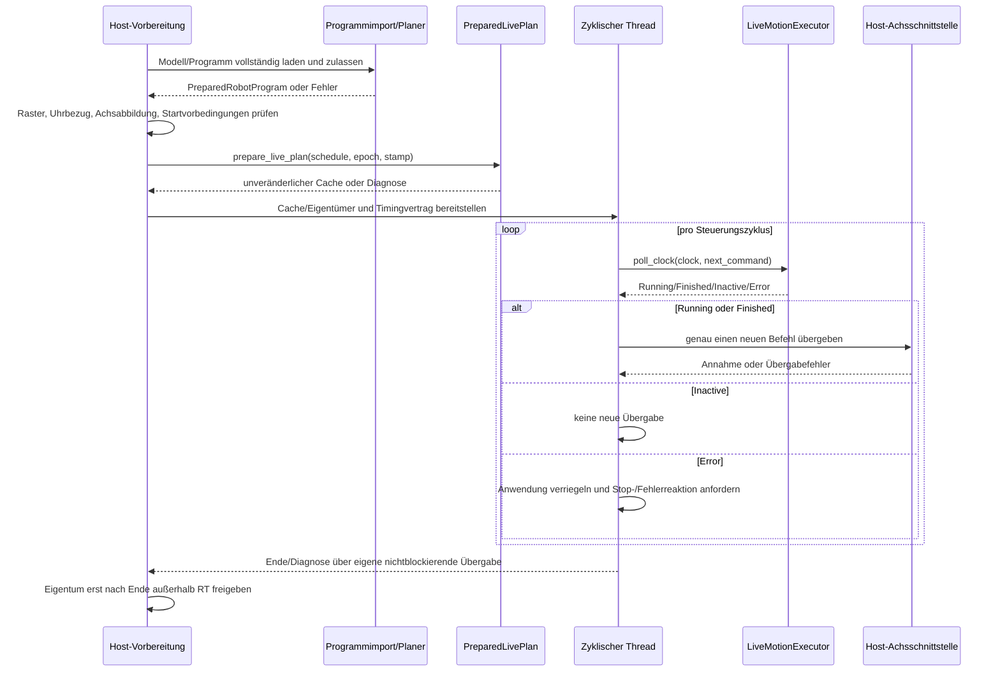
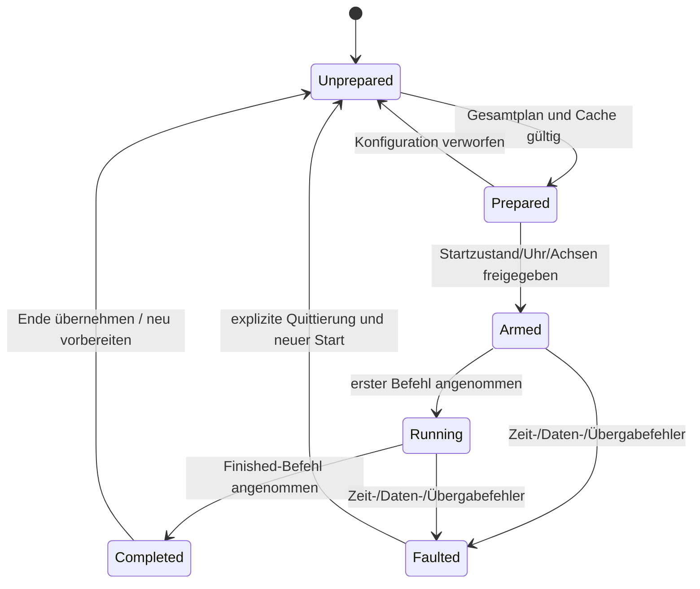
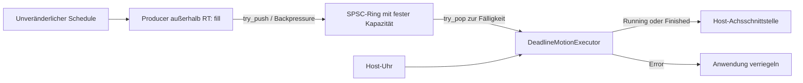

# Laufzeitabläufe und Zustände

Die Sequenzen zeigen Rollen der späteren Host-Anwendung und vorhandene
Bibliotheksobjekte. Rollen wie „Achsschnittstelle“ oder „Freigabe“ sind noch
keine implementierten Hardwareadapter. Die sieben strukturellen UML-Sichten
stehen unter [Klassendiagramme](class_diagrams.md).

## Vorbereitung und zyklische Übergabe



Der Planer darf die Programmauswahl erst nach erfolgreichem Gesamtplan ersetzen.
Das Diagramm trennt Vorbereitung und Zyklus; es legt keine konkrete Anzahl
Prozesse/Threads eurer Eigenentwicklung fest. `poll_clock()` prüft Zeit vor der
Ausgabe, nicht die zukünftige Laufzeit eines beliebigen Treibers.

## Empfohlener Anwendungsautomat

Dies ist ein **Host-Vertragsentwurf**, kein zusätzlicher Bibliotheksautomat.



| Hostzustand | Wesentliche Zusage |
| --- | --- |
| Unprepared | Keine Bewegung aus einem unvollständigen Plan |
| Prepared | Vollständige Referenz und gültiger Cache, aber keine Hardwarefreigabe |
| Armed | Alle Host-Vorbedingungen erfüllt; erste Zeitfensterprüfung steht noch aus |
| Running | Jeder neue Befehl wird höchstens einmal übergeben |
| Completed | Terminaler Stillstandsbefehl wurde angenommen; tatsächliche Ist-Ruhe separat überwachen |
| Faulted | Keine weiteren normalen Befehle; eigener Stop-/Fehlerpfad und neue Freigabe erforderlich |

Eine Stopanforderung ist nicht gleichbedeutend mit einem bestätigten physischen
Stillstand. `Finished` beschreibt das Ende der Sollreferenz, nicht automatisch
alle Zustände eurer Maschine. Pausieren, Rückwärtsfahren und Wiederanlauf aus
beliebigem Istzustand sind mit diesem Automaten nicht automatisch implementiert.

## Live-Aktivierung und Retirement

```mermaid
sequenceDiagram
    participant Planner as Planer/Eigentümer
    participant Box as LivePlanMailbox
    participant Exec as Zyklischer Executor
    Planner->>Planner: neuen Cache ab exaktem aktivem q/dq/ddq-Randzustand bauen
    Planner->>Box: try_offer(candidate)
    Note over Planner,Box: Kandidat bleibt bis Antwort unverändert am Leben
    Exec->>Box: service_requests()
    Box-->>Exec: höchstens eine offene Referenz
    Exec->>Exec: Identität, Takt, Uhr, Vorlauf, Zustand und Fence prüfen
    alt Kandidat nicht zulässig
        Exec->>Box: Ablehnungsantwort
        Planner->>Box: try_response(response)
        Planner->>Planner: Kandidat außerhalb RT freigeben
    else Kandidat zulässig
        Exec->>Exec: bis Wechsel-Tick alten Cache ausgeben
        Exec->>Exec: am Tick Kandidat aktivieren, Snapshot veröffentlichen
        Exec->>Box: Activated(new, retired_generation)
        Planner->>Box: try_response(response)
        Planner->>Planner: neuen Cache behalten, alten nach allen Lesern freigeben
    end
```

Das Postfach hat eine offene Anfrage. `try_offer()` mit belegtem Postfach liefert
false. Weder über denselben Speicher einen zweiten Kandidaten unterschieben noch
im RT-Pfad auf eine Antwort warten. Kopierte Befehlswerte in einem Treiber
verlängern keine Cache-Lebensdauer; geliehene Host-Referenzen dagegen schon.

## Gepufferter Producerpfad



Eine volle Queue pausiert den Producer. Eine leere Queue zur Fälligkeit ist ein
Fehler, kein Auftrag zum Warten, Extrapolieren oder Wiederholen des alten Werts.
Ein paralleler Beobachter liest eigene Statusdaten bzw. im Cachepfad `snapshot()`.
