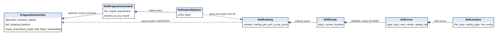

# DXF als Programmbefehl

Ab Bibliothek **0.13.0** liest der YAML-Befehl `DXF` eine externe Zeichnung und
plant deren Punkte beziehungsweise Mittellinien mit dem vorhandenen C++-Planer.
Der Editor **0.4.0** bietet Dateiimport und Befehlseinfügung. DXF-Einlesen und
Planung finden vollständig vor der Ausführung statt; im zyklischen Dispatcher
wird keine CAD-Datei geöffnet oder interpretiert.

## Direkt ausprobieren

```sh
python3 tools/motion_viewer/run_editor.py --open
```

Im Browser **„UR5e · DXF-Kontur abfahren“ → Vorlage laden → Simulieren** wählen.
Das Beispiel enthält genau einen DXF-Befehl und danach WAIT. Der Befehl ergibt
vier LIN-Stücke und einen echten Viertelkreis als CIRC. Im Viewer bleiben
Programmzeile, DXF-Datei, DXF-Zeile, Entity und Layer nachvollziehbar.
**Bahn fokussieren** vergrößert die TCP-Bahn; **Ansicht zurücksetzen** zeigt
wieder den ganzen Roboter.

Eine eigene Zeichnung mit **DXF öffnen** laden, Einheit/Layer/Bezug und
Verbindungsfahrten einstellen, dann **DXF-Befehl einfügen** drücken. Der Helfer
ergänzt den mehrzeiligen `steps:`-Block; die Parameter bleiben als normaler
Programmtext sichtbar. Die Änderung wird erst mit **Simulieren** geplant.

Für den C++-Simulator ohne Editor:

```sh
./build/program_simulator programs/examples/ur5e_dxf_demo.yaml --check
./build/program_simulator programs/examples/ur5e_dxf_demo.yaml --csv build/dxf_trace.csv
```

## Befehl und Koordinaten

```yaml
steps:
  - type: DXF
    file: kontur.dxf
    units: mm
    layer: PATH
    reference: tcp
    travel: LIN
    speed: 0.5
    path_tolerance_m: 0.0002
  - {type: WAIT, seconds: 0.2}
```

| Parameter | Bedeutung / Standard |
| --- | --- |
| `file` | DXF-Datei; CLI relativ zur YAML-Datei, Editor nur geladener Dateiname ohne Verzeichnisse |
| `units` | `auto` (Standard), `mm`, `cm`, `m`, `inch`, `ft`; explizite Auswahl hat Vorrang vor `$INSUNITS` |
| `layer` | Optionaler exakter Layername; ohne Auswahl werden alle Entities geprüft |
| `reference` | `tcp` (Standard) oder `world` |
| `placement` | Optionale Pose `{position: [x,y,z], orientation: [w,x,y,z]}`; Standard Identität |
| `travel` | `reject` (Standard), `LIN` oder `PTP` für Anfahren und Verbindungen zwischen getrennten Stücken/Punkten |
| `orientation` | Optionales normiertes TCP-Quaternion in Weltkoordinaten; sonst TCP-Orientierung am Befehlsstart beibehalten |
| `speed` | Bisheriger Geschwindigkeitsfaktor; mit globalem `speed` kombiniert, effektiv 0,001–1 |
| `path_tolerance_m` | Positionstoleranz der vorhandenen Spline-Abbildung; Standard 0,0002 m, zulässig 0,000001–0,001 m |

`units: SI` im YAML bleibt unverändert. Nur die DXF-Zahlen erhalten die gewählte
Zeichnungseinheit. **`placement.position` steht immer in Metern.**
Die DXF-Ebene ist lokal XY, +Z ist ihre Normale. Eine Platzierung kann diese
Ebene beliebig starr im Raum drehen und verschieben:

```text
reference: tcp   Weltpunkt = TCP_am_Befehlsstart × placement × DXF-Punkt_in_m
reference: world Weltpunkt = placement × DXF-Punkt_in_m
```

TCP-Bezug wird **einmal pro DXF-Befehl** am Anfang bestimmt, nicht bei jedem
Vertex neu. Ein wiederholter CALL mit TCP-Bezug kann deshalb eine weitere Kontur
relativ zur dann erreichten Stellung erzeugen. Weltbezug bleibt ortsfest.
Die Werkzeugorientierung folgt keiner Tangente und wird durch `placement`
nicht automatisch geändert.

Beispiel für eine ortsfeste Zeichnung, um 90° um Welt-Z gedreht:

```yaml
  - type: DXF
    file: kontur.dxf
    units: mm
    reference: world
    placement:
      position: [0.7, 0.3, 0.25]
      orientation: [0.7071067811865476, 0, 0, 0.7071067811865475]
    travel: LIN
    speed: 0.5
```

Diese Beispielplatzierung ist kein universell erreichbarer Arbeitsbereich.
Die vollständige IK-/Gelenk-/TCP-Zulassung entscheidet anhand des importierten
Roboters und seiner Grenzen.

## Unterstützte Zeichnungselemente

| Entity | Interpretation |
| --- | --- |
| `POINT` | Wegpunkt; Fahrt dorthin gemäß `travel`, kein automatisch eingefügter Haltzeit-Befehl |
| `LINE` | Räumliche Gerade vom Anfangs- zum Endpunkt |
| `LWPOLYLINE` | Offene/geschlossene 2D-Polylinie mit Elevation und signierten Bulge-Bögen |
| `POLYLINE` / `VERTEX` / `SEQEND` | Einfache offene/geschlossene 2D- oder 3D-Polylinie; 3D ohne Bulge |
| `ARC` | Kreisbogen gegen den Uhrzeigersinn; Winkel in DXF-Grad, einschließlich Umschlag über 0° |
| `CIRCLE` | Vollkreis, Start am lokalen positiven X-Radius |

Eine positive Bulge läuft gegen, eine negative mit dem Uhrzeigersinn; auch
Bögen über 180° bleiben echte Kreisgeometrie. Polylinien-Schließkanten werden
berücksichtigt. Breiten und Strichdarstellung werden als Darstellungseigenschaften
behandelt: gefahren wird die **Mittellinie**, ohne Werkzeugradiuskorrektur.

Entities werden in Dateireihenfolge, Polylinien in Vertex-Reihenfolge bearbeitet.
Es gibt keine automatische Sortierung, Umkehrung oder Wegeoptimierung.
Ein Eintritt oder Sprung zu einer anderen Kontur wird bei `travel: reject`
abgelehnt, wenn die Posen nicht zusammenpassen. Mit `travel: LIN/PTP` werden
diese Verbindungen ausdrücklich Bestandteil der geprüften Bewegung. Der
Einfügehelfer zeigt seine Auswahl und schreibt sie in das YAML.

Jede erzeugte LIN-/CIRC-/PTP-Bewegung hat nach dem bestehenden Programmvertrag
Stillstandsgrenzen. Das ist eine geometrisch und dynamisch geprüfte Abfolge,
noch keine durchgehende Bearbeitungsbahn mit Verschleifen oder Prozess-I/O.

Nicht unterstützt werden binäre DXF, DWG, SPLINE, ELLIPSE, INSERT/BLOCK-Auflösung,
Mesh-/Polyface-/Fit-Polylinien, Papierbereich und andere Extrusionsnormalen als
lokal +Z. Solche **ausgewählten** Entities führen zu einer Diagnose; sie werden
nicht still ausgelassen. Beschriftungen auf anderen Layern können durch eine
Layerauswahl ausgeschlossen werden. Einheitenlose Zeichnungen benötigen eine
explizite Einheit. Der Editor erwartet ASCII-/UTF-8-Text, keine beliebige
Legacy-Zeichencodierung.

## Planung, Genauigkeit und Datenhaltung

Der Importer erzeugt SI-Geometrie, keine vorab berechneten Achsbefehle. Erst
danach werden die existierenden LIN-/CIRC-/PTP-Planer, IK-Abbildung, Hüllen und
Sollwertsimulation aufgerufen. Auch ein späterer fehlerhafter DXF-Abschnitt
verhindert die Freigabe des gesamten neuen Programms.

Serielle IK-Endpunkte können vom idealen CAD-Anschluss geringfügig abweichen.
Ein importierter Bogen verwendet deshalb den exakten CAD-Radiusvektor relativ
zum tatsächlich erreichten Anfangspunkt. Anfang und Ende jedes importierten
Kurvenstücks müssen innerhalb **1 µm** ihrer nominalen CAD-Punkte liegen;
sonst wird abgelehnt. Das ersetzt nicht die separate Spline-Pose-Abbildung:
deren Positionstoleranz ist über `path_tolerance_m` einstellbar, standardmäßig
**0,2 mm**. Diese Einstellungen sind Modell-/Planungsgrößen, kein Nachweis der
realen Maschinengenauigkeit. Kollisionen, Werkzeugradius, Schnittkräfte,
Spindel-/Ventilsteuerung und eine sichere Zustellung werden nicht erzeugt.

Im Editor werden YAML und DXF-Text gemeinsam zum Auftrag eingefroren. Das
Ersetzen/Entfernen einer DXF kennzeichnet die vorhandene Simulation als älteren
Stand. Die letzte gültige Ansicht bleibt bei Fehlern erhalten. Der Download
**Programm + DXF als ZIP** enthält den exakt simulierten YAML-Stand und seine
Anhänge. Ein reiner YAML-Download enthält die Zeichnung nicht.

Der Browser versucht, DXF-Anhänge mit dem Entwurf lokal zu speichern. Bei
Speicherplatzmangel zeigt er eine Meldung; Originaldateien beziehungsweise das
ZIP müssen dann separat aufbewahrt werden. Für den CLI-Import das Bundle so
ablegen, dass seine relativen Profilpfade stimmen; im Editor ist das Modell
relativ zum Projekt-Hauptordner, der DXF-Dateiname relativ zum Auftrag.

## C++-API und Grenzen

```cpp
#include "motion/io/dxf_path_import.hpp"
#include "motion/program/robot_program.hpp"

auto drawing = motion::load_dxf_path_file("kontur.dxf",
    {motion::DxfUnit::Millimetre, std::string("PATH")});
auto source = motion::parse_robot_program_yaml(yaml_text, "programm.yaml");
auto prepared = motion::compile_robot_program(source, imported_robot,
    [] (const std::string& name) { return my_asset_snapshot.at(name); });
```

Der optionale `ProgramAssetLoader` liefert DXF-Text, beispielsweise aus einem
bereits geprüften Speicherabbild. Wiederholte Referenzen auf denselben Dateinamen
werden innerhalb einer Kompilierung nur einmal geladen. Ohne Callback liest
die Bibliothek relativ zur Programmdatei. Parsing, Dateizugriff, Speicherbelegung
und Planung gehören vollständig außerhalb des Echtzeitthreads.

Grenzen: 4 MiB pro nativer DXF, 16 MiB/acht Dateinamen pro Kompilierung,
250.000 Gruppen, 20.000 Entity-Records, 5.000 ausgewählte Entities,
10.000 Kurvenstücke sowie insgesamt 10.000 expandierte Programmschritte.
Der Editor begrenzt Anhänge zusätzlich auf vier Dateien mit je 1 MiB;
die vollständige JSON-Anfrage ist auf 12 MiB begrenzt. Seine bisherigen
Simulations-/Zeitbudgets bleiben bestehen.



Der native Importer ist in `io/`, die Befehlsexpansion in `program/` getrennt.
Editor und Visualisierung bleiben unter `tools/motion_viewer/`.
