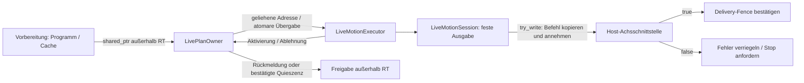

# Verwaltete Pläne, Befehlsannahme und Shutdown

Ab **0.14.0** ist `LiveMotionSession<N>` der empfohlene Cachepfad für eine
Steuerungseinbindung. Sie verbindet den vorhandenen `LiveMotionExecutor` mit
einem `LivePlanOwner` und einer synchronen Achsannahme. Es gibt keinen eigenen
Thread, keinen Scheduler und keinen Feldbusadapter. Die Host-Steuerung bestimmt
weiterhin Takt, Istwertüberwachung, Freigaben und physische Stopreaktion.

## 1. Zwei Rollen, ein Besitzer

| Rolle | Methoden | Vertrag |
| --- | --- | --- |
| Ein Managementthread | `plans().try_offer()`, `collect_response()`, `request_cancel()`, `release_after_shutdown()` | Darf planen, shared_ptr verwalten und Caches freigeben; nicht im RT-Zyklus aufrufen |
| Ein zyklischer Thread | `dispatch()` oder `dispatch_clock()` | Feste Befehle prüfen, höchstens einmal übergeben und deren Annahme bestätigen |
| Beliebige parallele Leser | `snapshot()`, `diagnostic()`, `plans().state()` | Begrenzte atomare Leseoperationen, keine Cache-Adressen |
| Beliebiger Thread | `plans().request_shutdown()` | Atomare Anforderung; wartet nicht auf deren Umsetzung |

Sitzung und Owner sind weder kopierbar noch verschiebbar. Sie werden außerhalb
RT konstruiert und zerstört. Der Owner hält höchstens einen aktiven und einen
angebotenen Cache. Im RT-Pfad werden nur geliehene Adressen benutzt; dort
werden keine shared_ptr kopiert oder freigegeben. Weitere vom Host gehaltene
Referenzen können die Speicherlebensdauer zusätzlich verlängern.



## 2. Vorbereiten und starten

```cpp
#include <motion/execution/live_motion_session.hpp>

// In der Vorbereitung, aus dem bereits geprüften schedule:
auto cached = motion::prepare_live_plan<6>(schedule, epoch_s, {1, 0, 0, clock_id});
if (!cached)
  throw std::runtime_error(cached.diagnostic);

motion::LiveMotionSession<6> session(std::move(cached.plan), timing_policy);
```

Erst danach startet der Host seinen zyklischen Aufruf. Der Zustand `Running`
bedeutet, dass die Sitzung Befehle und Planangebote verarbeiten kann. Er ist
keine Aussage über eine Hardwarefreigabe oder tatsächliche Istbewegung. Die
bekannten Start-/Uhr-/Achsprüfungen aus dem [Integrationshandbuch](controller_integration.md)
gelten weiterhin.

## 3. Der Annahmevertrag der Achsschnittstelle

Der Sink muss diese beiden Operationen anbieten:

```cpp
bool try_write(const motion::LiveJointCommand<6>& command) noexcept;
void request_stop() noexcept;
```

`try_write()` muss den **gesamten Befehl einschließlich Generation und Tick**
innerhalb seiner begrenzten Aufrufdauer kopieren und endgültig annehmen oder
ablehnen. Die Referenz auf das Argument darf nicht gespeichert werden.

- **true:** Der Befehl ist unwiderruflich übernommen. Die Sitzung bestätigt
  anschließend `commit_delivery(generation, tick)` für genau diesen Tick.
- **false:** Keine Wiederholung, kein Überspringen und kein Weiterlaufen.
  Die Sitzung verriegelt `SinkRejected`, fordert einmal `request_stop()` an
  und beendet weitere normale Ausgabe. Auch eine Ablehnung des terminalen
  Befehls ergibt `Error`, kein erfolgreiches Ende.

Der Vertrag unterstützt eine synchrone Annahme durch einen Host-Puffer. Eine
spätere physische Ausführung oder Antriebsbestätigung ist damit nicht behauptet.
Bei partieller Übertragung gilt `false`; der Host muss den Fehlerpfad für bereits
übertragene Anteile beherrschen. Asynchrone Annahme mit späterem Ack benötigt
eine eigene Integration; die Sitzung bietet dafür kein Wiederholungsprotokoll.

```cpp
// Zyklischer Eigentümer; clock.now() und beide Sink-Methoden sind noexcept.
const auto status = session.dispatch_clock(clock, axes);
// Running/Finished: Befehl ist bereits übergeben und bestätigt.
// Nicht zusätzlich selbst try_write() oder commit_delivery() aufrufen!
// Inactive: keine neue Übergabe. Error: weitere Ausgabe ist verriegelt.
```

`Finished` wird erst nach Annahme des letzten Stillstandsbefehls zurückgegeben.
Weitere Aufrufe liefern `Inactive`, ohne denselben Befehl nochmals zu senden.
Die Session kann die Laufzeit eines fremden Sinks nicht vorhersagen.
`dispatch_latency_bound_s` muss deshalb dessen begründete maximale Dauer und
die zugehörige Übergabearbeit abdecken. `noexcept` allein begrenzt keine Laufzeit.

## 4. Plan anbieten und Retirement einsammeln

Der neue Cache wird weiterhin außerhalb RT ab dem **exakten** aktiven
q/dq/ddq-/Zeitstempelzustand eines zukünftigen Ticks zugelassen. Die Sitzung
ändert keine Bewegungsplanung oder Zulassungsbedingungen.

```cpp
// Ein Managementthread; candidate ist bereits vollständig vorbereitet.
const auto offered = session.plans().try_offer(candidate);
if (offered) {
  candidate.reset(); // Der Owner hält den Kandidaten jetzt selbst am Leben.
}

// Regelmäßig außerhalb RT aufrufen:
if (const auto response = session.plans().collect_response()) {
  // Activated: neuer Cache bleibt erhalten, alter wurde hier freigegeben.
  // Ablehnung/Cancelled/Shutdown: Kandidatenreferenz wurde hier freigegeben.
}
```

`LivePlanOfferStatus` ist ein synchroner Managementstatus:

| Code | Bedeutung |
| --- | --- |
| `Offered` | Adresse sicher übergeben, noch keine Aktivierungszusage |
| `Busy` | Ein Angebot oder dessen ungelesene Antwort ist noch offen |
| `InvalidPlan` | Leerer Kandidat |
| `GenerationReused` | Nummer wurde in dieser Sitzung bereits angeboten oder ist älter |
| `Stopping` | Shutdown angefordert oder bereits bestätigt |

Jede **veröffentlichte Angebotsgeneration** ist größer als alle vorherigen,
auch wenn ein früheres Angebot abgelehnt wurde. Der letzte Wert steht in
`last_offered_generation()`. Der Host vermeidet Überlauf und wählt die nächste
Nummer. `parent_generation` bezeichnet weiter die tatsächlich aktive Referenz.
Diese Trennung verhindert, dass eine verspätete Abbruchanforderung ein späteres
Angebot mit wiederverwendeter Nummer trifft. Die eigentliche Aktivierungsprüfung
und deren `LiveResponseStatus` erfolgen weiterhin im Executor.

Eine `Activated`-Rückmeldung besagt, dass die alte Referenz nicht mehr gelesen
wird. Sie bestätigt noch keine physische Annahme der neuen Bewegung. Falls der
Sink anschließend ablehnt, entscheidet das verriegelte Session-Diagnostic über
den Ausführungsfehler; die alte Cache-Referenz kann trotzdem sicher freigegeben werden.

## 5. Ein Angebot zurücknehmen

```cpp
const bool requested = session.plans().request_cancel();
// requested bestätigt nur den Auftrag, nicht dessen Erfolg.
```

Vor der nächsten Ausgabe versucht der zyklische Thread die benannte Generation
zu entfernen. Vor der Aktivierung lautet die Antwort `Cancelled`; der alte
Plan läuft weiter. War die Aktivierung bereits erfolgt, bleibt `Activated` die
definitive Antwort. Ein Abbruchwunsch nimmt weder einen übernommenen Befehl noch
eine bereits aktive Bewegung zurück. Für deren Beendigung braucht der Host
einen passenden Halt-/Fehlerpfad.

## 6. Shutdown mit nachgewiesener Speicherfreigabe

```mermaid
sequenceDiagram
    participant M as Management
    participant S as LiveMotionSession
    participant RT as Zyklischer Thread
    participant A as Host-Sink
    M->>S: plans().request_shutdown()
    S-->>M: angefordert; noch keine Freigabe
    RT->>S: nächster dispatch_clock()
    opt terminaler Befehl noch nicht angenommen
        S->>A: request_stop() genau einmal
    end
    S->>S: Executor trennt aktive / ausstehende Cache-Adressen
    S->>S: Quiescent mit Release veröffentlichen
    S-->>RT: Inactive (bei verriegeltem Fehler weiterhin Error)
    M->>S: plans().state() mit Acquire lesen
    M->>S: plans().release_after_shutdown()
    S->>S: alle Cache-Referenzen außerhalb RT freigeben
    M->>RT: Thread beenden und joinen
    M->>S: Sitzung zerstören
```

Die Zustandsfolge ist `Running → ShutdownRequested → Quiescent`. Ein
Ausführungs-/Annahmefehler führt direkt zu `Quiescent`, behält aber seine
Fehlerdiagnose. Die Sitzung wird danach nicht automatisch wieder freigegeben
oder gestartet; dafür ist eine neue, vom Host freigegebene Sitzung nötig.

1. `request_shutdown()` ist idempotent und wartet nicht.
2. Ein bereits laufender Dispatch darf seine Übergabe noch abschließen. Erst
   `Quiescent` bestätigt, dass kein Aufruf mehr Cache-Adressen lesen wird.
3. Vor dieser Bestätigung liefert `release_after_shutdown()` **false** und
   behält sämtliche Referenzen.
4. Nach der Bestätigung werden alle Pläne freigegeben, einschließlich einer
   ungelesenen Aktivierungsantwort oder eines gleichzeitig mit einem Shutdown oder Fehler
   eingetroffenen Angebots. Eine einzelne Antwort kann bei diesem letzten
   Grenzfall entfallen; Quieszenz ist die abschließende Retirement-Zusage für alle.
5. Spätere Dispatch-Aufrufe greifen nicht mehr auf Caches/Postfach zu und geben
   keine neuen Befehle aus. Die Sitzung selbst bleibt bis zum Ende aller Aufrufe
   am Leben: **erst Thread beenden/joinen, dann Sitzung zerstören**.

Wenn der zyklische Thread nicht mehr aufgerufen wird, erfolgt keine automatische
Shutdown-Quittierung. Nach einem extern nachgewiesenen Join darf der Host die
gesamte Sitzung außerhalb RT zerstören; eine Freigabe während noch möglicher
Aufrufe darf er daraus nicht ableiten. Es gibt keinen blockierenden Destruktor.

Ein normales Ende benötigt keine zusätzliche Stopanforderung, wenn der terminale
Befehl bereits angenommen wurde. Bei Shutdown während einer Bewegung oder bei
einem Fehler wird der Sink einmal benachrichtigt. **Quiescent bedeutet keine
bestätigte physische Ruhe.** Kontrolliertes Abbremsen, Bus-/Antriebsreaktion und
Ist-Ruhe sind weiterhin Aufgaben der Steuerung. Der Shutdown erzeugt selbst
keine Bremsbahn.
Bereits angenommene Treiberbefehle werden dadurch nicht zurückgenommen. Das
Abbrechen oder Entleeren einer Host-/Antriebsqueue gehört zur Stopreaktion.

## 7. Beobachtung und Fehlerursachen

`snapshot()` ist der kohärente Executor-Snapshot. `next_tick` beschreibt die
bereits erzeugte Referenz, `committed_through` nur unwiderruflich angenommene
Befehle. Während eines Sinks-Aufrufs können beide auseinanderliegen. Bei
Quieszenz steht `generation=0`, das neue Feld `quiescent=true` kennzeichnet
die beendete Referenzbenutzung. `finished` beschreibt weiterhin den terminalen
Referenztick; bei einer Sink-Ablehnung ist zusätzlich das Session-Diagnostic maßgeblich.

`diagnostic()` liefert einen einmal geschriebenen, danach unveränderten
`LiveSessionFault`: `code`, `execution_fault`, `generation`, `tick`.

| Code | Ursache |
| --- | --- |
| `Execution` | Zeit-/Uhrfehler; genauer Grund in `execution_fault` |
| `SinkRejected` | Host lehnt den erzeugten Befehl ab; keine Wiederholung |
| `CommitRejected` | Interne Delivery-Bestätigung unerwartet fehlgeschlagen; Ausgabe ebenfalls verriegelt |

Ein fehlerfreier Shutdown erzeugt kein Diagnostic. Snapshot, Zustandsabfrage und
Diagnostic sind jeweils sicher lesbar, aber bilden zusammen keine einzige
atomare Gesamttransaktion. Für Speicherfreigabe ist ausschließlich die
Acquire-gelesene `plans().state()==Quiescent` maßgeblich, geprüft durch
`release_after_shutdown()`.

Im getrennten Producerpfad enthält `BufferFillResult::diagnostic` ab 0.14.0
außerdem Code, fehlerhaften Tick und die ursprüngliche `exception_ptr`.
`std::rethrow_exception(result.diagnostic.cause)` erhält den Originaltyp auch
für eigene Provider-Ausnahmen. Das geschieht außerhalb RT. Nach einem
Referenzfehler liefert der Producer dauerhaft `Error` und sampelt nicht erneut.
`count` zählt die bereits veröffentlichten gültigen Präfixbefehle; ein Fill ist
keine atomare Veröffentlichung des gesamten Programms. Der Host muss auf den
Fehler reagieren, statt die Queue unbeaufsichtigt weiter abzuarbeiten.

## 8. Einstieg und bestehende Schnittstellen

```sh
./build/controller_contract_example programs/examples/ur5e_demo.yaml 1 normal
./build/controller_contract_example programs/examples/ur5e_demo.yaml 20 normal
./build/controller_contract_example programs/examples/ur5e_demo.yaml 10 sink-refusal
./build/controller_contract_example programs/examples/ur5e_demo.yaml 10 shutdown
```

Das Beispiel verwendet die neue Sitzung, eine ideale Uhr und eine simulierte
Achsannahme. Der [Prüfnachweis](../testing/live_session_validation.md) beschreibt
Lebensdauertests, Nebenläufigkeit, Allokationsprüfung und Sanitizer.

Der rohe `LiveMotionExecutor` und die alten Includes bleiben verfügbar. Wer ihn
direkt nutzt, ist weiter selbst für Besitz, Annahme, Rückmeldungen und Fehler
verantwortlich. Seine neuen `cancel_offer()` und `shutdown()` sind ausschließlich
Operationen des zyklischen Eigentümers. Nach `shutdown()` muss der Host neue
rohe Postfachangebote unterbinden. Die verwaltete Sitzung erledigt dies über
ihren Owner. Wegen der erweiterten Header-Typen/Enums müssen Verbraucher neu
übersetzt werden; eine stabile binäre ABI ist nicht zugesagt.
