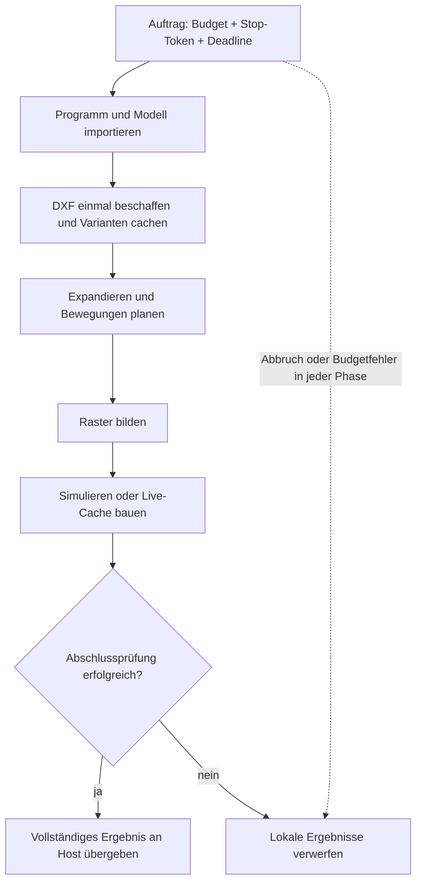

# Ressourcen und Abbruch der Vorbereitung — ab 0.16.0

Die Vorbereitung läuft auf einem **Nicht-RT-Worker**. Ein `PreparationContext`
verbindet Import, Planung, Rasterung, Simulation und Cachebau zu einem Auftrag.
Er enthält kumulative Zähler, ein C++20-Stop-Token und optional eine absolute
`steady_clock`-Deadline. Es gibt keinen globalen oder threadlokalen Kontext.

Die bisherigen Überladungen bleiben verfügbar und behalten ihre lokalen Limits.
Die neuen Überladungen nehmen einen `PreparationContext*`; `nullptr` aktiviert
keine gemeinsamen Limits. Der Viewer verwendet den Kontext standardmäßig.
Der zyklische Dispatcher benötigt ihn nicht und fragt keine Uhr/Stop-Tokens ab.

## Zuständigkeit und Lebensdauer

Ein Worker besitzt und verändert den Kontext. Andere Threads dürfen über die
zugehörige `std::stop_source` einen Abbruch anfordern. Sie dürfen Zähler und
Fehlerzustand erst nach dem Join lesen. Der Kontext wird weder im vorbereiteten
Programm noch im fertigen Cache gespeichert. Er muss bis zum Ende der aufgerufenen
Vorbereitungsfunktion leben; fertige Pläne dürfen länger leben.

```cpp
#include "motion/program/robot_program.hpp"
#include "motion/execution/live_motion_executor.hpp"

std::stop_source cancellation; // An den Bedien-/Auftragsthread weitergeben.
motion::PreparationBudget budget;
budget.work = 2000000;
budget.cache_bytes = 40 * 1024 * 1024;
motion::PreparationContext preparation(
    budget, cancellation.get_token(),
    motion::PreparationContext::Clock::now() + std::chrono::seconds(60));

// Diese Arbeit gehört auf den Vorbereitungsworker.
auto program = motion::load_robot_program("programs/examples/ur5e_demo.yaml", &preparation);
auto report = motion::simulate_robot_program(program, nullptr, {1000000, &preparation});
auto live = motion::prepare_live_plan<6>(
    program.schedule, program.schedule->initial_state().timestamp_s,
    {1, 0, 0, 7}, 200000, &preparation);
if (!live) throw std::runtime_error(live.diagnostic);
// Erst nach erfolgreichem Abschluss an LiveMotionSession übergeben.
```

`cancellation.request_stop()` fordert einen kooperativen Abbruch an. Der Worker
beendet die Vorbereitung an einem Checkpoint mit `PreparationError`.
`code()`, `resource()` und `phase()` unterscheiden `Cancelled`,
`DeadlineExceeded` und `BudgetExceeded`. Der erste Fehler bleibt verriegelt;
ein fehlgeschlagener Kontext kann nicht für einen neuen Auftrag benutzt werden.
Ein neuer Auftrag erhält einen neuen Kontext. Überläufe der Zähler werden abgelehnt.

## Budgetvertrag

| Feld | Default | Zählweise |
| --- | ---: | --- |
| input_bytes | 32 MiB | YAML-Programmtext, URDF/Profil und einmalig beschaffter Text je DXF-Dateiname |
| assets | 8 | Beschaffte DXF-Dateien pro Kompilierung |
| drawings | 32 | Tatsächliche DXF-Parsevorgänge, einschließlich unterschiedlicher Importoptionen |
| instructions | 10.000 | Zu planende Befehle nach CALL/DXF-Expansion, einschließlich WAIT/Travel |
| work | 10.000.000 | YAML-Knoten, Expansion, DXF-Gruppen/Entities, Modellgelenke, IK-Iterationen/Linesearch, Spline-/Envelope-Intervalle, Rastersegmente und Live-Samples |
| simulation_ticks | 1.000.001 | Wirklich simulierte Befehle, einschließlich Anfangs- und Endbefehl |
| cache_bytes | 64 MiB | Kumulativ zugelassene DXF-Cache-Nutzdaten und angeforderte feste Live-Kommandos |

Die Work-Einheit ist ein **Zulassungszähler**, keine CPU-Zeit. Eine IK-Iteration
und ein Envelope-Intervall kosten unterschiedlich viel. Die Deadline begrenzt
die tatsächlich verstrichene Zeit zusätzlich. `used(resource)` liefert nach
Abschluss den Verbrauch. Phasen werden nicht mit neuen Limits gestartet.

Beispiel: 200.000 `FixedJointCommand<6>` benötigen 35,2 MB reine Befehlsdaten.
Zwei solcher vollständigen Caches benötigen 70,4 MB und überschreiten ein
**gemeinsames** 64-MiB-Budget. Der Live-Cache prüft den Bytebedarf vor `reserve()`
und vor dem ersten Sample, reserviert einmal und prüft jeden Tick sowie den
Abschluss. Die vorhandene Kapazitätsgrenze schließt den Anfangsbefehl ein.

**Cache-Nutzdaten sind keine Gesamt-RAM-Grenze.** Gezählt werden angeforderte
Live-Kommandos sowie Kapazitäten der DXF-Vektoren und Zeichenketten einschließlich
konservativ mitgezählter Stringpuffer. Nicht enthalten sind Allocator-Metadaten,
Solvermatrizen, Parserbäume, Programmpolynome oder fremde Hostobjekte. Ein
Zeichnungs-Parse wird vor seiner Aufnahme in den Cache abgeschlossen und kann
zusätzlichen begrenzten Scratch-Speicher benötigen. Beim Verwerfen eines
Zwischenergebnisses werden kumulative Zähler nicht zurückgesetzt.

Der Kontext ist auch kein globaler Speicherpool: mehrere Kontexte haben getrennte
Budgets. Der Host muss aktive/angebotene Pläne und gleichzeitig laufende Jobs in
seinem Anlagenbudget berücksichtigen. Eine automatische globale RAM-Reservierung
oder Wiederverwertung von Budgets über Generationen hinweg ist nicht implementiert.

## DXF-Cache

Pro `compile_robot_program()` wird Text je **exaktem Dateinamen** einmal beschafft.
Geparste Zeichnungen werden nach `(Dateiname, units, optional layer)` wiederverwendet.
Platzierung, TCP-Referenz, Geschwindigkeit und Travel werden erst bei jeder
Verwendung expandiert; sie dürfen das zwischengespeicherte CAD-Modell nicht ändern.
Einheiten- oder Layerwechsel erzeugen einen eigenen Parse. Es gibt höchstens
32 Varianten, auch ohne gemeinsamen Kontext.

Das ist ein unveränderlicher Snapshot pro Kompilierung, kein prozessweiter
Dateicache. Änderungen auf der Platte werden beim nächsten Auftrag neu geladen.
Es werden keine Pfade zusammengeführt, die ein eigener Loader unterschiedlich
behandeln könnte. Der direkte `parse_dxf_path(..., context)` zählt Parse/Work;
sein Aufrufer zählt die Beschaffung der Eingabebytes. Der Programmcompiler erledigt
beides. Es gibt weiterhin keinen Dateizugriff beim Sampling.

## Abbruchpunkte und Ergebnisveröffentlichung



Checkpoints liegen in der YAML-Ereignisprüfung, Expansion, DXF-Tokenisierung und
Entity-Verarbeitung, serieller IK samt Linesearch, Spline-/Envelope-Rekursion,
Rasterung, je Simulationstick und Live-Cache-Sample. Vor der Rückgabe wird erneut
geprüft. Ein Abbruch beim letzten Cache-Sample darf kein fertiges Ergebnis liefern.
Die neu angelegten Programme/Caches bleiben lokal; bereits ausgegebene Programme
werden durch einen fehlgeschlagenen neuen Auftrag nicht verändert.

Die Ausnahme enthält einen Phasennamen statt eines vorgetäuschten Syntaxfehlers.
Normale Syntax-/Geometriefehler behalten ihre bisherigen Quellorte und Typen.
Eine direkte Simulation in einen vom Aufrufer gelieferten `ostream` kann bei einem
späten Fehler bereits Zeilen geschrieben haben. Für atomare Dateien schreibt der
Host in eine temporäre Datei und benennt erst nach erfolgreichem Abschluss um.

**Kooperativ ist keine harte Präemption:** Dateisystemaufrufe, ein fremder
`ProgramAssetLoader`, YAML-/XML-Bibliotheksaufrufe, einzelne Matrixoperationen und
fremde Kinematikcallbacks können nicht mitten im Aufruf unterbrochen werden.
Die bestehenden Eingabe-/Tiefenlimits bleiben zusätzlich bestehen, etwa 1 MiB
Programm, 128 KiB Profil, 8 MiB URDF, 4 MiB je DXF und 16 MiB DXF-Text insgesamt.
Ein eigener Loader muss seinerseits begrenzt und abbrechbar sein. Diese Software-
Deadline liefert keinen WCET- oder Maschinenhalt-Nachweis.

## Editor und Spurverarbeitung

Das Werkzeug bleibt unter `tools/motion_viewer/` und verwendet dieselbe Bibliothek.
Ab Werkzeugversion **0.5.0** gilt `--timeout-s` für den gesamten Auftrag bis zur
Ergebnisfreigabe: native Vorbereitung, Simulation, Spurprüfung und HTML-/ZIP-Erzeugung.
Die Restzeit wird an den nativen Exporter weitergegeben; dieser benutzt denselben
C++-Kontext für alle eigenen Phasen. CLI-Aufrufe des Exporters haben standardmäßig
120 s, ein gesetztes `MOTION_PREPARATION_TIMEOUT_MS` erlaubt 1–3.600.000 ms.

Der Browser gibt jedem Lauf eine zufällige `job_id`. **Abbrechen** sendet eine
lokale, tokengeprüfte `POST /api/cancel` mit genau dieser Kennung. Der Worker beendet
und reap't seinen nativen Prozess oder stoppt die Python-Aufbereitung. Eine
unpassende/abgeschlossene Kennung liefert `cancelled: false`; ein zugesagter Abbruch
wird mit der Veröffentlichung unter demselben Lock geordnet. Ein alter Preview
bleibt erhalten. Pro Editor läuft weiterhin höchstens ein Auftrag, drei gültige
Ergebnisse werden aufbewahrt. Shutdown fordert zuerst den Abbruch an und wartet
vor dem Löschen seiner Dateien auf den Worker.

Der C++-Exporter spoolt CSV bis 64 MiB auf Platte und kopiert sie blockweise in
das bisherige JSON-v1-Format. Python prüft in einem ersten Durchlauf **alle** Zeilen,
Grenzen und Peaks; es hält nur Skalare und Segmentwechselindizes. Der zweite
Durchlauf behält höchstens `max_frames` numerische Zeilen. Ein Zeileniterator
vermeidet auch eine vollständige `StringIO`-Unicode-Kopie. Anfang, Ende und beide
Seiten eines Segmentwechsels bleiben erhalten; zu viele Pflichtpunkte werden
abgelehnt. Die Ausdünnung beeinflusst keine Grenzprüfung.

Das JSON-v1-Format enthält weiterhin die vollständige CSV als String. JSON-Laden,
Meshes und fertiges HTML sind weiterhin begrenzte, aber materialisierte Objekte.
Die Prüfung ist somit speichersparend, aber kein vollständig streamender JSON-
Parser. Python-Schritte prüfen zwischen Zeilen und vor/nach begrenzten größeren
Operationen; während eines einzelnen `json.load`/`render_html` gibt es keine harte
Präemption. Vor der Veröffentlichung wird das Gesamtzeitbudget erneut geprüft.

[Klassendiagramm](../architecture/diagrams/preparation.svg) ·
[Prüfnachweise und Reproduktion](../testing/resources_validation.md).
