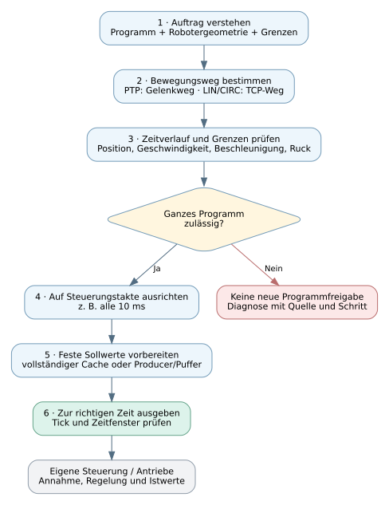
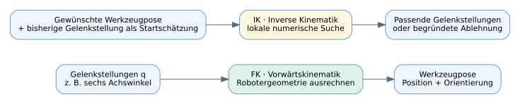
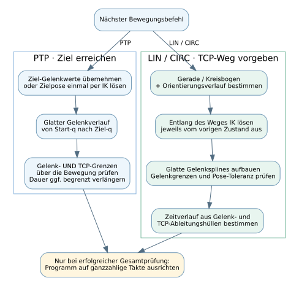
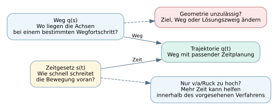
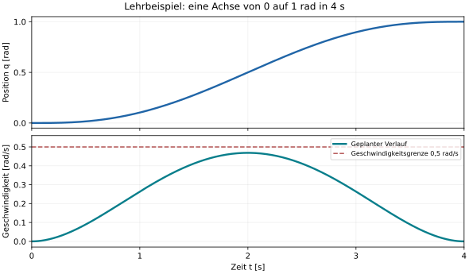
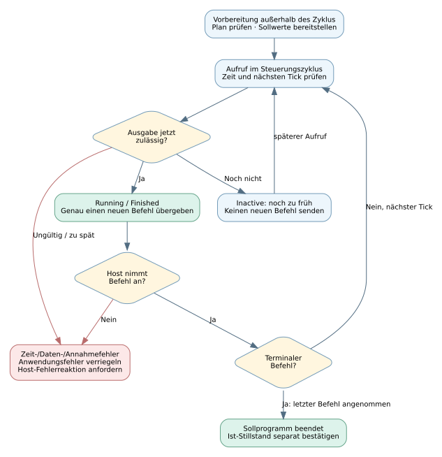

# Bewegungsplanung verstehen – ein kleines Tutorial

**Für wen?** Für alle, die nachvollziehen möchten, wie aus „Fahre dorthin“ eine
Folge von Achssollwerten wird. Du brauchst dafür keine Kenntnisse über
Robotik-Solver. Lesedauer ungefähr 10–15 Minuten.

Wir betrachten unsere vorhandene Bibliothek: serielle Roboter, Programme mit
PTP/LIN/CIRC/WAIT und eine spätere Eigensteuerung mit 1–20 ms Takt. Die Diagramme
erklären die Softwareabläufe als vereinfachte Übersichten; Details stehen bei den
weiterführenden Links. Sie legen noch keine konkrete Hardwareanbindung fest.

## 1. Die Grundidee: ein Auftrag wird zu vielen kleinen Sollwerten

Stell dir einen Greifer vor, der von einer Ablage zu einem Werkstück fahren soll.
„Zum Werkstück“ reicht den Motoren als Information nicht. Die Software muss wissen:

- Wo stehen die Achsen am Anfang, und welches Ziel ist gemeint?
- Welchen Weg sollen Greifer und Achsen nehmen?
- Wie schnell dürfen sie sich bewegen, beschleunigen und ihre Beschleunigung ändern?
- Welche Achswerte müssen zu welchem Zeitpunkt ausgegeben werden?

Daraus entsteht eine **Trajektorie**: eine Bewegung mit festgelegtem Zeitverlauf.



**Wichtig:** Beim hier betrachteten YAML-Programmimport wird zunächst das ganze
Programm vorbereitet und geprüft. Erst danach werden feste Sollwerte ausgegeben.
Wird beim Planen ein späterer Schritt als ungültig erkannt, verhindert das die
Freigabe dieses neuen Gesamtprogramms. Es wird nicht erst ein halbes
Programm gefahren und dann der Rest geplant.

## 2. Die wichtigsten Begriffe ohne Vorkenntnisse

| Begriff | Anschauliche Bedeutung |
| --- | --- |
| Gelenk / Achse | Eine bewegliche Verbindung des Roboters: drehend oder verschiebend |
| Gelenkstellung `q` | Die Winkel bzw. Wege aller Achsen, in einer festen Reihenfolge |
| TCP | Der gedachte Arbeitspunkt des Werkzeugs, z. B. die Greiferspitze |
| Pose | Position **und** Orientierung eines Körpers oder Werkzeugs |
| Kinematik | Der geometrische Zusammenhang zwischen Achsen und Werkzeugpose |
| Bahn / Weg | Wo die Bewegung entlangführt, zunächst ohne feste Dauer |
| Trajektorie | Bahn **mit** Zeitverlauf: Wo sind die Achsen zur Zeit t? |
| Sollwert | Der geplante Wert, den die Steuerung ausgeben soll |
| Istwert | Der tatsächlich gemessene Wert der Maschine |
| Zyklus / Tick | Ein Ausführungsschritt des vereinbarten Zeitrasters |

Intern gelten SI-Einheiten: m, rad und s. Ein Radiant entspricht ungefähr 57,3°.
Drehachsen und Schiebeachsen können in einer Kette gemischt sein. Deshalb ist
ein Gelenkvektor nicht automatisch eine Liste von sechs Gradwerten.

### Wie kommen Geometrie und Grenzen ins Projekt?

Die **URDF** beschreibt Gelenke, Achsen und geometrische Abstände. Das **SI-YAML-
Profil** ergänzt die zulässigen Bewegungsgrenzen sowie Basis und Werkzeug.
Das **Anwenderprogramm** beschreibt Ziele und Bewegungsbefehle.

Diese drei Informationen erfüllen verschiedene Aufgaben: Ein geometrisch
bekanntes Ziel ist noch keine zulässige Bewegung, und ein Programmstartwert
ist noch kein bestätigter Istwert der Maschine.

## 3. FK und IK: zwei unterschiedliche Fragen an dieselbe Geometrie



**Vorwärtskinematik, kurz FK:** „Wenn alle Achsen so stehen, wo ist dann der TCP?“
Die Software setzt die geometrischen Transformationen entlang der Kette zusammen.
Das braucht sie beispielsweise, um die TCP-Bahn einer PTP-Bewegung zu berechnen.

**Inverse Kinematik, kurz IK:** „Welche Achsstellungen bringen den TCP zu dieser
Pose?“ Dazu können mehrere Lösungen existieren, etwa unterschiedliche
Ellbogenstellungen. Unsere serielle IK sucht lokal von einer vorgegebenen
Startschätzung aus. Sie findet eine passende Lösung oder liefert eine Ablehnung.
Eine abgelehnte lokale Suche beweist nicht, dass überhaupt keine Lösung existiert.

Bei einer **Singularität** verliert die Kinematik in bestimmten Richtungen
Bewegungsmöglichkeiten: Für eine kleine gewünschte TCP-Änderung können sehr
große Achsänderungen nötig werden. Deshalb prüft die Software auch die
Kondition der Lösung. Einfach länger fahren behebt nicht jede solche Situation.

## 4. PTP, LIN und CIRC geben unterschiedliche Dinge vor

| Befehl | Was der Auftrag vorgibt | Was du am Roboter erwarten kannst |
| --- | --- | --- |
| **PTP** | Ziel-Gelenkstellung oder Zielpose | Die Achsen fahren einen glatten Gelenkverlauf. Die TCP-Bahn darf gekrümmt sein. |
| **LIN** | Zielposition und eine TCP-Gerade mit gehaltener TCP-Orientierung ab der aktuellen Pose | Die Kinematik wird entlang der Geraden gelöst; die Achsen müssen dazu nicht linear laufen. |
| **CIRC** | Kreismittelpunkt bzw. Versatz, Normale und Drehwinkel | Der TCP folgt einem Kreisbogen; auch vollständige Kreise sind möglich. |
| **WAIT** | Eine Wartezeit | Der Sollzustand bleibt im Stillstand. Es wird keine neue IK-Bahn benötigt. |

Ein gemeinsames Ziel bedeutet also **nicht dieselbe Bewegung**. PTP ist passend,
wenn vor allem das Erreichen der Zielkonfiguration zählt. LIN ist passend, wenn
der Werkzeugweg gerade sein soll, beispielsweise beim geraden Einführen.



### Was macht unsere Implementierung dabei?

**PTP:** Ist das Ziel schon als Gelenkvektor angegeben, wird es direkt verwendet.
Bei einer Zielpose wird zunächst IK gelöst. Danach entsteht eine Gelenkquintik,
also ein glattes Polynom fünften Grades. Zusätzlich zu den Gelenkgrenzen werden
die daraus entstehenden TCP-Grenzen geprüft. Falls nötig, wird die Dauer innerhalb
begrenzter Versuche verlängert; ohne erfolgreichen Nachweis wird abgelehnt.

Für normale LIN-Schritte bleibt ab 0.16.1 die TCP-Orientierung im Weltbezug
konstant. Eine gewünschte Drehung zur Zielpose benötigt ausdrücklich
`orientation_mode: interpolate`. Arm- und Handachsen gleichen ihre Bewegung
entsprechend aus. [Programmvertrag](../formats/robot_program_yaml.md#lin-und-tcp-orientierung).

**LIN/CIRC:** Zunächst wird der gewünschte TCP-Weg mit seinem Orientierungsverlauf
festgelegt. Entlang dieses Wegs löst die Software wiederholt IK, jeweils mit der
vorigen Gelenkstellung als Startschätzung. Aus den Lösungen entstehen glatte
Gelenksplines. Diese müssen in einem vorgegebenen **Pose-Toleranzschlauch** bleiben.
Danach bestimmt die Zeitplanung eine Dauer aus den Gelenk- und TCP-Hüllen.

Die Abbildung ist numerisch: Eine LIN-Bahn wird innerhalb der zugelassenen
Toleranz an die ideale Gerade angenähert, nicht als fehlerfreie reale Gerade
behauptet. Die Orientierung gehört zur Pose und wird ebenfalls berücksichtigt.
Eine Grenze oder ein begrenztes Rechenbudget kann zur begründeten Ablehnung führen.

## 5. Weg und Zeit getrennt denken

Nehmen wir an, der gewünschte Weg ist schon bekannt. Dann bleibt die Frage:
Wie schnell soll der Roboter an welcher Stelle sein?



Der Buchstabe **s** bezeichnet den Wegfortschritt: 0 am Anfang, 1 am Ende.
`q(s)` sagt, welche Achsstellungen zu diesem Fortschritt gehören. `s(t)` sagt,
wie sich der Fortschritt über der Zeit entwickelt. Zusammen ergibt das `q(t)`.

Diese Trennung hilft bei Grenzprüfungen:

- **Ein zu schneller Verlauf** kann häufig durch mehr Zeit zulässig werden.
- **Eine unzulässige Gelenkstellung** bleibt auch bei langsamer Fahrt unzulässig.
- **Eine nicht gelöste IK oder ein unpassender Weg** braucht eine andere zulässige
  Lösung bzw. eine erfolgreiche Abbildung; bloßes Verlangsamen genügt nicht.

Die Zeitplanung ist im aktuellen Stand konservativ. Eine zugelassene Bewegung
ist deshalb nicht automatisch die weltweit schnellstmögliche Bewegung.

## 6. Warum Geschwindigkeit allein nicht ausreicht

Die Bibliothek prüft mehrere Größen gleichzeitig, für die Gelenke und den TCP:

| Größe | Frage | Wie heißt sie in den Gelenkdaten? |
| --- | --- | --- |
| Position | Bleiben die Achsen in ihrem erlaubten Bereich? | `q` |
| Geschwindigkeit | Wie schnell ändert sich die Position? | `dq` |
| Beschleunigung | Wie schnell ändert sich die Geschwindigkeit? | `ddq` |
| Ruck | Wie schnell ändert sich die Beschleunigung? | Separater Ruckvektor / `jerk` im Export |

Ein plötzlicher Sprung der Geschwindigkeit würde eine sehr große Beschleunigung
verlangen. Sehr abrupte Änderungen der Beschleunigung führen zu hohem Ruck.
Die glatte Zeitplanung begrenzt diese Größen; die konkreten Grenzen kommen aus
dem Modellprofil und dem Geschwindigkeitsfaktor des Programms.

Nicht nur ein paar sichtbare Punkte werden geprüft. Der Planer benutzt auch
**numerische Hüllen**, also obere/untere Abschätzungen über ganze Abschnitte.
Denn zwischen zwei unauffälligen Punkten kann trotzdem ein Grenzmaximum liegen.
Diese Engineering-Prüfungen sind keine formal zertifizierte Intervallarithmetik.
Die Kurven im Viewer sind zusätzliche anschauliche Samples.

## 7. Ein kleines Zahlenbeispiel

Wir wählen **für dieses Lehrbeispiel** eine Drehachse:

- Start 0 rad, Ziel 1 rad, erlaubter Positionsbereich −2 bis +2 rad.
- Geschwindigkeit höchstens 0,5 rad/s, Beschleunigung höchstens 1 rad/s²,
  Ruck höchstens 5 rad/s³.
- Start und Ziel im Stillstand. Zur Veranschaulichung setzen wir die Dauer auf **4 s**.

Die Tabellenwerte wurden gegen `plan_boundary_quintic()` abgeglichen.
Das ist ein gewähltes Einachsbeispiel, keine Messung und nicht die Behauptung,
dass der automatische Sechsachsplaner genau diese Dauer auswählt. Die verwendete
ruhende Quintik ergibt gerundet:

| Zeit | Position q | Geschwindigkeit dq |
| --- | --- | --- |
| 0 s | 0,0000 rad | 0,0000 rad/s |
| 1 s | 0,1035 rad | 0,2637 rad/s |
| 2 s | 0,5000 rad | 0,4688 rad/s |
| 3 s | 0,8965 rad | 0,2637 rad/s |
| 4 s | 1,0000 rad | 0,0000 rad/s |



Die Achse bewegt sich am Anfang und Ende langsam und dazwischen schneller.
Die maximale Geschwindigkeit beträgt 0,46875 rad/s; die Beschleunigung erreicht
etwa 0,36085 rad/s², der Betrag des Rucks höchstens 0,9375 rad/s³. Damit bleiben
alle gewählten Grenzen eingehalten.

**Stillstand heißt hier:** Geschwindigkeit und Beschleunigung sind am Rand null.
Der Ruck muss bei dieser Quintik am Rand nicht null sein. Begrenzter Ruck ist
auch nicht gleichbedeutend mit überall stetigem Ruck.

### Daraus werden Steuerungstakte

Bei **10 ms** Zykluszeit liegen die Befehle auf diesem Raster:

```text
Tick       0       1       2      ...      399      400
Zeit     0,00 s  0,01 s  0,02 s   ...    3,99 s   4,00 s
q        Start   ...     ...      ...     ...     Ziel
```

Das sind **400 Zeitintervalle und 401 Befehle**, weil Start und Ende dazugehören.
Hätte eine andere geplante Bewegung beispielsweise 4,003 s Dauer, würde die
Ausrichtung auf 10 ms sie auf 4,010 s verlängern. Sie wird nicht durch
Abschneiden verkürzt. Das Raster ist die zeitliche Ausgabeplanung, nicht die
Bildwiederholrate des Browsers.

## 8. Planung und zyklische Ausgabe erfüllen verschiedene Aufgaben

Die Vorbereitung darf rechnen, Speicher anfordern und ein ungültiges Programm
zurückweisen. Die zyklische Ausgabe arbeitet mit bereits vorbereiteten festen
Befehlen. Dafür gibt es den vollständigen Cache oder einen von außen gefüllten
SPSC-Puffer; SPSC heißt ein Producer und ein Consumer.



Im laufenden Zyklus wird insbesondere geprüft: Passt die Uhrdomäne? Ist die
Zeit ausreichend genau und nicht zurückgesprungen? Ist der nächste Befehl
vollständig und im zulässigen Zeitfenster?

- `Running`: einen neuen Befehl übergeben.
- `Finished`: auch diesen **letzten** Stillstandsbefehl einmal übergeben.
- `Inactive`: keinen neuen Befehl senden; der Aufruf kann zu früh sein oder das
  Programm bereits beendet. Der alte Ausgabewert darf nicht erneut gesendet werden.
- `Error`: Fehler verriegeln und die vereinbarte Host-Fehlerreaktion anfordern.
  Es gibt kein automatisches Aufholen oder Weiterlaufen nach dem Fehler.

Nimmt die Host-Achsschnittstelle einen Befehl nicht an, muss die Anwendung
zusätzlich die weitere Übergabe sperren. Eine Stopanforderung und ein bestätigter
physischer Stillstand sind unterschiedliche Ereignisse.

## 9. Ein Programm besteht aus mehreren solchen Bewegungen

Unser YAML-Programmimport plant die normalen PTP-/LIN-/CIRC-Schritte mit
**Stillstand an den Segmentgrenzen**. Eine Folge von LIN-Befehlen bedeutet daher
nicht automatisch eine durchgehende Bewegung ohne Abbremsen. Blending, also das
gezielte Verschleifen von Übergängen, ist eine gesonderte Planungsfunktion.

`CALL` löst ein benanntes Unterprogramm bereits vor der Ausführung auf. Es startet
keinen fremden Skriptprozess. `WAIT` hält den Sollzustand für die geplante Zeit.
Das ganze expandierte Programm muss zugelassen sein, bevor es veröffentlicht wird.

Der Planer ist außerdem **kein Antriebsregler**: Eine reale Steuerung muss die
Sollwerte korrekt zuordnen, Antriebe bedienen und Istwerte/Fehler überwachen.
Zulässige Gelenk-/TCP-Grenzen sind auch keine automatische Prüfung jeder
möglichen Kollision des gesamten Roboters.

## 10. Im Viewer selbst nachvollziehen

Öffne die fertige Datei
`tools/motion_viewer/demo/ur5e_motion.html` im Browser. Die Anleitung und eine
Vorschau stehen beim [separaten Viewer-Werkzeug](../../tools/motion_viewer/README.md).
Nach dem Herunterladen lässt sich auch die
[fertige Viewer-Demo](../../tools/motion_viewer/demo/ur5e_motion.html) lokal öffnen.

1. Spiele den ersten **PTP** ab. Sieh, wie sich mehrere Achsen gleichzeitig ändern;
   der TCP muss dabei keine Gerade beschreiben.
2. Springe zu **LIN**. Betrachte die Werkzeugbahn und die dazu nötigen Gelenkverläufe.
3. Wähle **CIRC**: Die Demo enthält einen vollständigen Kreis.
4. Wähle **WAIT**: Die Gelenkpositionen bleiben stehen, dq/ddq sind null.
5. Schalte unten zwischen Position, Geschwindigkeit, Beschleunigung und Ruck um.
   Mit „Profilfenster“ kannst du die Gelenkkurve gegen die ganzen Profilgrenzen sehen.
6. Gehe zum letzten Sample: Der terminale Sollwert ist im Stillstand. Das ist eine
   Simulation und noch keine Istwertbestätigung einer Maschine.

## 11. Wo geht es fachlich und im Code weiter?

| Frage | Einstieg |
| --- | --- |
| Wie importiere ich mein Programm? | [Programmformat](../formats/robot_program_yaml.md) |
| Wie beschreibe ich den Roboter? | [URDF und SI-Profil](../formats/robot_model_yaml.md) |
| Welche Klasse hat welche Aufgabe? | [Modulkatalog](../architecture/module_catalog.md) und [Klassendiagramme](../architecture/class_diagrams.md) |
| Wie bindet unsere Steuerung das ein? | [Integrationshandbuch](../integration/controller_integration.md) |
| Wie funktionieren Threads und Live-Wechsel? | [Technische Laufzeitabläufe](../architecture/runtime_flows.md) |
| Welche Nachweise gibt es? | [Prüfbericht](../testing/validation.md) |

Für den ersten Quellcodeblick: `compile_robot_program()` wählt den Planungszweig,
`map_cartesian_spline()` bildet kartesische Wege ab, `PathTimeParameterizer`
bestimmt deren Zeitverlauf und `align_program_cycles()` legt das Raster fest.
Erst `DeadlineMotionExecutor` bzw. `LiveMotionExecutor` übernehmen die zeitlich
geprüfte Ausgabe. Du musst diese Klassen nicht alle verstehen, um die oben
beschriebenen Schritte im Viewer wiederzuerkennen.
