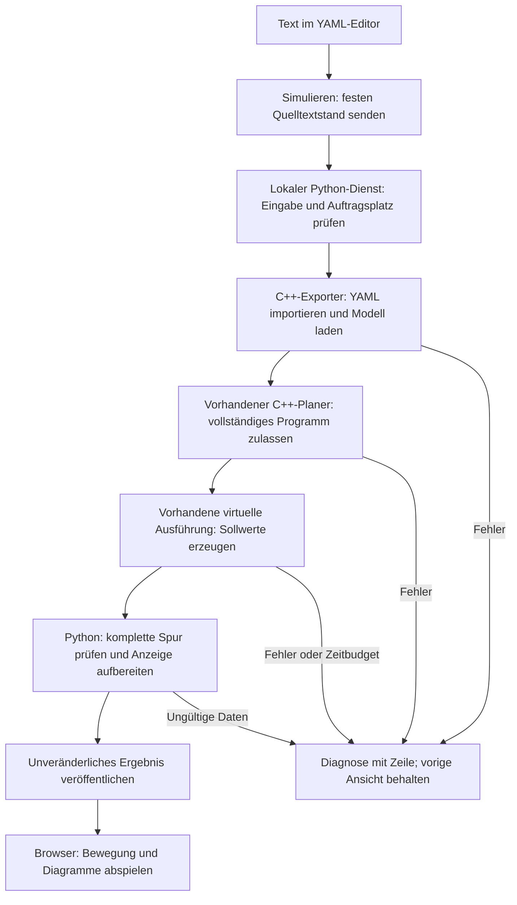
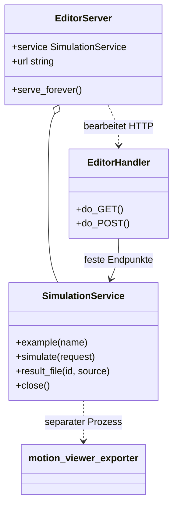

# Lokaler Programmeditor und Simulation

## Pick-and-Place-Vorlage

Das Beispiel-Dropdown enthält **„UR5e · Pick and Place“**. **Vorlage laden**
übernimmt `programs/examples/ur5e_pick_place.yaml` und setzt den Profilpfad
automatisch auf `models/ur5e/profile_pick_place_simulation.yaml`.
Das separate Simulationsprofil muss erhalten bleiben; es darf nicht durch das
konservative Standardprofil ersetzt werden. Die Vorlage enthält zwei Zyklen
und keine DXF-Anhänge. Die bestehenden Beispiele behalten ihre bisherigen Profile.
Die höheren Grenzwerte sind Simulationsannahmen, keine Hardwarefreigabe.

## DXF-Dateien und ein Bahnbefehl (0.4.0)

**DXF öffnen** lädt bis zu vier Text-DXF-Dateien mit je maximal 1 MiB.
Einheit, Layer, TCP-/Weltbezug und Verbindungsfahrten einstellen und
**DXF-Befehl einfügen** drücken. Der Helfer ergänzt das Ende eines mehrzeiligen
`steps:`-Blocks, auch vor späteren `points:`-/`subprograms:`-Feldern. Bei einer
einzeiligen Flow-Liste den Befehl manuell eintragen oder zuerst auf einen
mehrzeiligen Block umstellen.

Das Beispiel **„UR5e · DXF-Kontur abfahren“** enthält Zeichnung und fertigen
Befehl. **Simulieren** liest die Geometrie nativ ein und plant sie mit den
bestehenden LIN-/CIRC-/PTP-Planern. **Bahn fokussieren** vergrößert die Kontur.
Die Anzeige nennt auch CAD-Datei, Entity, DXF-Zeile und Layer.

Im Editor muss `file` ein geladener **Dateiname ohne Verzeichnisse** sein.
Beim Öffnen vorhandener CLI-Programme also beispielsweise
`file: ../dxf/rounded_path.dxf` auf `file: rounded_path.dxf` anpassen und die Datei
zusätzlich laden. Beim YAML-Import bleiben bereits geladene DXF-Dateien erhalten.
Eine Beispielvorlage ersetzt dagegen bewusst den kompletten Entwurf samt Anhängen.

**Programm + DXF als ZIP speichern** sichert den exakt simulierten Stand samt
Anhängen. Ein reiner YAML-Download enthält die DXF-Dateien nicht. Die lokale
Entwurfsspeicherung berücksichtigt auch DXF-Inhalte; bei einem vollen Browserspeicher
bleiben Originaldateien/ZIP die Sicherung. Wird eine DXF ersetzt oder entfernt,
ist die alte Simulation nicht mehr als aktueller Stand markiert.

Unterstützte Entities, Einheiten, Genauigkeit und Anschlussverhalten:
[DXF-Befehlsvertrag](../../docs/formats/dxf_program_command.md).

Der Editor liegt vollständig unter `tools/motion_viewer/`. Er nutzt den
vorhandenen C++-Programmimport, Planer und virtuellen Dispatcher. Es gibt keinen
zweiten Bewegungsplaner im JavaScript und keine Verbindung zu Achsen oder CANopen.

## Starten

Voraussetzungen: Python ≥3.9, CMake ≥3.20 und ein C++20-Compiler. Alle benötigten
Quellarchive, Visual-Meshes und JavaScript-Dateien sind im Projekt enthalten.
Es werden keine zusätzlichen Python-/JavaScript-Pakete benötigt.

Die eingebetteten Viewer-Dateien und Lizenztexte werden explizit als UTF-8
gelesen, unabhängig von der Standardkodierung des Betriebssystems.

Im Projekt-Hauptordner:

```sh
python3 tools/motion_viewer/run_editor.py --open
```

Im Browser **http://127.0.0.1:8765/** aufrufen, falls er nicht automatisch öffnet.
Das Terminal muss während der Arbeit geöffnet bleiben. **Strg+C** beendet den Dienst
und entfernt dessen temporäre Simulationsergebnisse. Der Browserentwurf bleibt
im lokalen Browserspeicher; heruntergeladene Dateien bleiben erhalten.

Weitere Startoptionen:

```sh
# Anderer freier Port, wenn 8765 bereits benutzt wird:
python3 tools/motion_viewer/run_editor.py --port 8766 --open

# Vorhandenen Exporter verwenden und den Build überspringen:
python3 tools/motion_viewer/run_editor.py \
  --exporter build-motion-viewer/motion_viewer_exporter --open

# Bestimmtes CMake / anderes separates Build-Verzeichnis:
python3 tools/motion_viewer/run_editor.py \
  --cmake /pfad/zu/cmake --build-dir build-motion-viewer-editor
```

Der Dienst bindet ausschließlich **127.0.0.1**. Wird er auf einem entfernten
Rechner gestartet, bezeichnet die ausgegebene Adresse diesen Rechner. Für
normalen Gebrauch Editor und Browser auf demselben Rechner starten. Der Server
ist kein öffentlich gehosteter Webdienst. `--port 0` wählt einen freien Port und
gibt die tatsächliche Adresse aus; Browserspeicher ist an diese Adresse gebunden.

## Vom ersten Programm zur Ansicht

1. UR5e-Vorlage verwenden oder über **YAML öffnen** eine UTF-8-Datei importieren.
2. Den Namen und den Programmtext bearbeiten. **Tab** fügt zwei Leerzeichen ein.
3. Das Sollwertraster zwischen 1 und 20 ms einstellen.
4. **Simulieren** oder **Strg/⌘+Enter** drücken. Währenddessen bleibt der Text editierbar.
5. Nach Freigabe im eingebetteten Viewer **Abspielen** drücken. Zeitregler,
   Einzelschritte, Programmsegmente, Mesh/Kinematik und Diagramme funktionieren
   wie in der separaten Viewer-Datei.
6. Den Entwurf mit **YAML speichern** sichern. **Simuliertes YAML speichern**
   enthält genau den zur angezeigten Simulation eingereichten Stand.
   **Viewer-HTML speichern** liefert die fertige, danach ohne Server abspielbare Ansicht.

Die Beispiele für ABB und FANUC verwenden dieselbe Planung und die Kinematikansicht.
Eine Vorlage wird erst mit **Vorlage laden** in das Textfeld übernommen;
das Ersetzen oder Öffnen eines Programms startet keine Simulation.

### Einheiten und Modellpfade

Es gilt das vorhandene [YAML-Programmformat](../../docs/formats/robot_program_yaml.md):
SI-Einheiten, Gelenkwinkel in **rad**, Positionen in **m**, Quaternionen als
**[w,x,y,z]**. Der kleine Editor hat keine eigene Programmiersprache.

Im Editor sind Modellpfade relativ zum **Projekt-Hauptordner**:

```yaml
schema_version: 1
units: SI
robot_profile: models/ur5e/profile.yaml
cycle_s: 0.01
start: {joints: [0.2, -0.6, 0.7, 0.3, 0.8, -0.2]}
steps:
  - {type: PTP, joints: [0.21, -0.6, 0.7, 0.3, 0.8, -0.2], speed: 0.5}
  - {type: WAIT, seconds: 0.2}
```

Ohne `robot_urdf` wird `robot.urdf` neben dem gewählten Profil geladen. Eigene
Profile und URDFs können unter `models/` abgelegt werden; ein expliziter
`robot_urdf`-Pfad beginnt entsprechend beispielsweise mit `models/mein_robot/`.
Absolute Pfade, Dateien außerhalb von `models/` und nach außen führende Symlinks
werden im Editor abgelehnt. Andere importierte Modelle erhalten die Kinematikansicht,
sofern keine passende Visual-Referenz hinterlegt ist.

Beim Öffnen bestehender Programme die Pfade gegebenenfalls anpassen: Aus
`../../models/ur5e/profile.yaml` wird im Editor `models/ur5e/profile.yaml`.
Die mitgelieferten Editorvorlagen sind bereits angepasst. Die heruntergeladene
YAML-Datei behält diesen Text unverändert. Bei späterer Nutzung mit dem normalen
CLI-Importer einen Pfad relativ zum tatsächlichen Speicherort verwenden;
im Projekt-Hauptordner gespeicherte Editor-YAML funktioniert dort direkt.

`cycle_s` ist das Planungsraster der ursprünglichen YAML-Referenz. Das separate
Feld **Sollwertraster** richtet diese zugelassene Referenz anschließend auf den
gewählten 1–20-ms-Takt aus, ohne Segmente zu verkürzen. Das entspricht dem
bisherigen `create_viewer.py --cycle-ms`-Verhalten.

## Fehler und Programmstände

- Parser-, Punkt-, Kinematik- und Grenzfehler stammen aus der nativen Bibliothek.
  Die Diagnose zeigt Zeile, Spalte und gegebenenfalls Schritt. **Fehlerstelle
  anzeigen** markiert die betreffende Zeile, solange der Entwurf noch zu diesem
  fehlgeschlagenen Auftrag gehört.
- Jeder Auftrag verwendet einen festen Quelltext-Schnappschuss. Weiteres Tippen
  verändert keinen laufenden Auftrag. Ein älteres Ergebnis wird als **Älterer
  Programmstand** gekennzeichnet; der neue Text wird nicht überschrieben.
- Nur nach vollständiger Planung, Simulation und Prüfung aller Trace-Samples
  entsteht eine neue Ansicht. Ein Fehler oder Timeout ersetzt keine gültige Ansicht.
- Es läuft höchstens ein nativer Auftrag gleichzeitig, auch bei mehreren Tabs.
  Andere Aufträge werden mit „Simulation läuft bereits“ abgelehnt, statt sich
  unbemerkt anzustauen.

Entwürfe werden nach kurzer Verzögerung im `localStorage` dieses Browsers
gespeichert. Das ist eine Komfortfunktion, keine Versionsverwaltung. Für eigene
Programme YAML herunterladen und im Projekt/Git sichern. Der Server hält nur die
**letzten drei erfolgreichen Ergebnisse** der laufenden Sitzung. Deren URLs sind
unveränderlich; ältere URLs laufen ab und müssen durch eine erneute Simulation
ersetzt werden. HTML und der exakt zugehörige YAML-Stand lassen sich vorher sichern.

## Ablauf und Zuständigkeiten



| Datei | Verantwortung |
| --- | --- |
| `run_editor.py` | CLI, eigener Build, lokaler Dienst und kontrolliertes Beenden |
| `tool_build.py` | Gemeinsamer Build-Einstieg für Editor und Demo |
| `editor_server.py` | HTTP-Endpunkte, Auftragsbegrenzung, temporäre Dateien, Ergebnisaufbewahrung |
| `native/export_program_scene.cpp` | Öffentliche Bibliotheks-APIs, eingeschränkte Modellpfade und strukturierte Editorfehler |
| `create_viewer.py` | Bestehende Datenvalidierung und eigenständige Offline-HTML |
| `web/editor.*` | Texteingabe, Import/Export, lokale Entwürfe und Kennzeichnung veralteter Ergebnisse |
| `web/viewer.*`, `web/mesh_renderer.js` | Bestehende Visualisierung im eingebetteten Frame |

Für den internen Editorbetrieb akzeptiert der Exporter zusätzlich
`PROGRAM.yaml OUTPUT.json CYCLE_MS MAX_TICKS --workspace PROJECT_ROOT`.
Nur dieser Modus verwendet die Editor-Pfadregeln und JSON-Diagnosen auf stderr.
Der bisherige CLI-Aufruf und die Programmpfadregeln der Bibliothek bleiben erhalten.
Die Simulationsausgabe wird nicht in die Bibliothek oder Steuerung zurückgeschrieben.



Die interne HTTP-Schnittstelle liefert Konfiguration und Vorlagen über
`GET /api/config` beziehungsweise `GET /api/examples/<id>`.
`POST /api/simulate` erwartet `{source, filename, cycle_ms, assets?}` und den Header
`X-Motion-Token` aus der lokalen Konfiguration. Eine erfolgreiche Antwort enthält
Zusammenfassung, Vorschau-URL und Download-URLs; Fehler liefern
`{error: {message, line?, column?, step?, block?, filename?}}`.
Diese Werkzeug-API ist kein Steuerungs- oder Feldbusprotokoll.

### Grenzen des lokalen Dienstes

`assets` ist eine Liste `{filename, content}` mit UTF-8-DXF-Text. YAML und
Anhänge werden zusammen eingefroren; die Ergebnisantwort liefert zusätzlich
`bundle_url` für das passende ZIP.

Maximal 1 MiB Programmtext / vier DXF-Dateien mit je 1 MiB / 12 MiB JSON-Anfrage,
99.999 Ticks / 100.000 Samples,
64 MiB CSV, 128 MiB beim JSON-Einlesen und standardmäßig 4.000 angezeigte Samples.
Das gesamte Auftragszeitbudget beträgt 120 s; `--timeout-s 30` ändert es (1–600 s).
Es gilt auch für Spurprüfung, HTML-Erzeugung und die abschließende Veröffentlichung.
Mit **Abbrechen** wird genau der laufende Auftrag beendet; die vorherige gültige
Ansicht bleibt erhalten. Ein bestätigter Abbruch veröffentlicht kein neues Ergebnis.
[Budgetvertrag und technische Grenzen](../../docs/integration/preparation_resources.md).
Der Exporter ist ein fest vorgegebenes Executable ohne Shell-Aufruf; Programmtext
führt keine Python-, JavaScript- oder Shell-Befehle aus. Der Server akzeptiert
nur seine lokalen Hostnamen und schützt Simulationsanfragen durch Sitzungstoken
und Origin-Prüfung. Es gibt keine CORS-Freigabe oder beliebige Dateiauslieferung.

Tests und tatsächlich ausgeführte Prüfungen stehen in [VALIDATION.md](VALIDATION.md).
