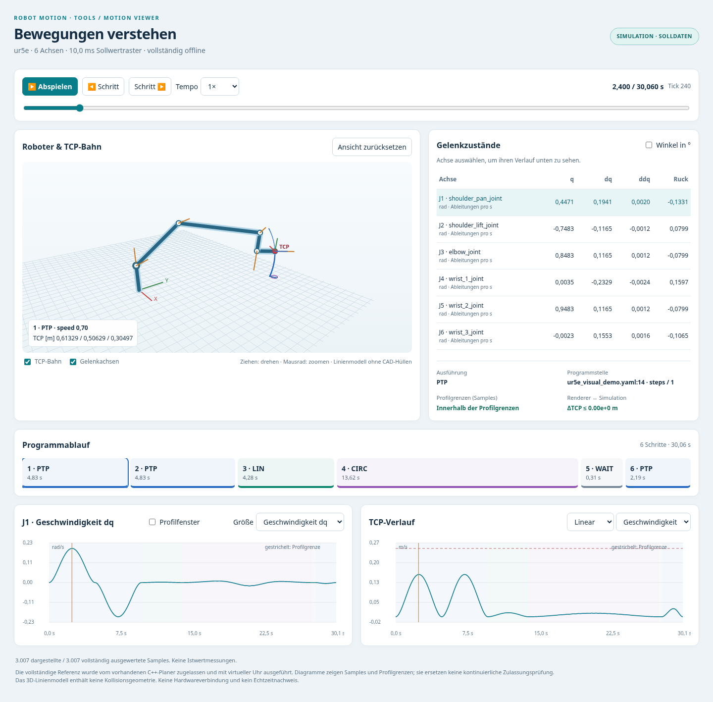
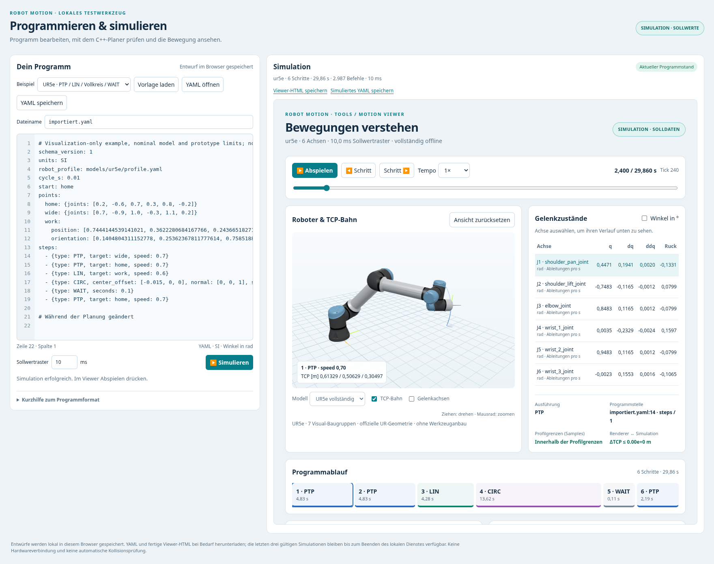
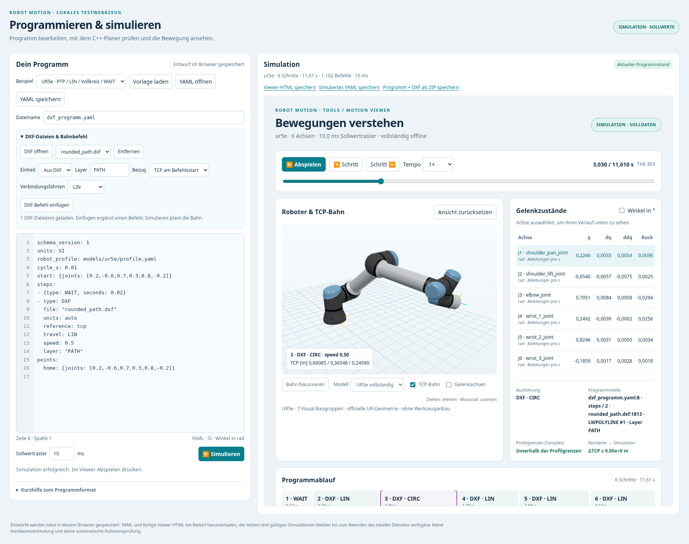

# Motion Viewer · separates Werkzeug 0.4.0

Ein **Offline-Viewer für die vorhandenen Bewegungsprogramme**, vollständig unter
`tools/motion_viewer/`. Bibliothek, Steuerungsschnittstellen und deren Build-
Konfiguration werden dafür nicht geändert. Ein kleiner eigener C++-Exporter
benutzt ausschließlich die öffentlichen Bibliotheksschnittstellen.

## Sofort ansehen – ohne Build

1. [Projekt mit Viewer, Editor und DXF-Befehl herunterladen](https://github.com/cpr-jar/Robotmotionplanning/archive/refs/tags/motion-viewer-v0.4.0.zip) und entpacken.
2. **`tools/motion_viewer/demo/ur5e_motion.html`** im Browser öffnen.
3. **Abspielen** drücken. Mit dem Zeitregler oder den Programmschritten gezielt
   zu einer Stelle springen; die 3D-Ansicht mit der Maus drehen und zoomen.

Unter **Modell** zwischen **UR5e vollständig** und **Kinematik** wechseln. Die
vollständige Darstellung enthält Basis, Schulter, Oberarm, Unterarm und alle drei
Handgelenke einschließlich der offiziellen Materialien. Ein Werkzeug ist nicht
angebaut; der rote Punkt und das kleine Koordinatensystem markieren den TCP.

Die fertige HTML-Datei enthält Modell, Daten, CSS und JavaScript. Sie benötigt
keinen Server, keine Installation, kein Internet und keinen Zugriff auf die
Steuerung. Browser mit einer Unternehmensrichtlinie gegen lokale Dateien können
sie bei Bedarf über einen eigenen lokalen HTTP-Server öffnen.
Die vollständige Ansicht benötigt WebGL; ohne WebGL bleibt die Kinematikansicht
mit einer verständlichen Meldung bedienbar. Es werden keine Modelle nachgeladen.



Die Demo zeigt größere PTP-Bewegungen, LIN, einen **vollständigen CIRC-Kreis**,
WAIT und die Rückkehr zum Start. Sie dauert ungefähr 30 s bei 10 ms Raster.
Ihre Grenzen sind die nominalen Beispielgrenzen des UR5e-Referenzmodells.

## Programme bearbeiten und direkt simulieren

Aus dem Projekt-Hauptordner:

```sh
python3 tools/motion_viewer/run_editor.py --open
```

Der Befehl baut den separaten C++-Exporter und startet den lokalen Editor unter
**http://127.0.0.1:8765/**. Im Editor YAML bearbeiten oder öffnen, ein Sollwertraster
zwischen **1 und 20 ms** wählen und **Simulieren** drücken. Nach erfolgreicher
Planung erscheint der vorhandene Bewegungsviewer mit dem vollständigen UR5e-Modell.
Mit **Abspielen** lässt sich die freigegebene Simulation ansehen. Vorlagen für
ABB und FANUC sind ebenfalls vorhanden; ihre Ansicht verwendet die Kinematik.



Fehler erscheinen mit Zeile und gegebenenfalls Schritt. Die letzte gültige
Simulation bleibt sichtbar. Der Editor kennzeichnet Änderungen seit dem
simulierten Stand, auch wenn sie während einer laufenden Planung erfolgen.
YAML-Entwürfe, das exakt simulierte YAML und fertige Offline-HTML können separat
gespeichert werden. Die [Editoranleitung](EDITOR.md) erklärt Importpfade,
Startoptionen, Datenhaltung und den Ablauf.

**Zum erneuten Planen muss der lokale Dienst laufen.** Die einzeln gespeicherte
Viewer-HTML kann weiterhin ohne Dienst geöffnet und abgespielt werden. Ein Browser
allein führt die native C++-Planung nicht aus. Die Steuerung wird nicht angesprochen.

## Was sichtbar wird

### DXF als ein Programmbefehl

Im Editor **„UR5e · DXF-Kontur abfahren“** laden und **Simulieren** drücken.
Eigene Zeichnungen mit **DXF öffnen** laden; **DXF-Befehl einfügen** schreibt
einen normalen YAML-Befehl mit Einheit, Layer, Bezug und Verbindungsfahrten.
POINT/LINE/Polylinien/Bögen/Kreise werden vom nativen Importer verarbeitet und
über die vorhandene C++-Planung abgefahren. Nicht unterstützte ausgewählte
Geometrie ergibt eine Diagnose. [Vollständige DXF-Anleitung](../../docs/formats/dxf_program_command.md).



**Programm + DXF als ZIP speichern** sichert den exakt simulierten Stand samt
Zeichnungen. Änderungen an einer geladenen DXF kennzeichnen das alte Ergebnis
als veraltet. Eine fertige Offline-Ansicht der Beispielkontur liegt unter
`demo/ur5e_dxf.html`. **Bahn fokussieren** vergrößert kleine Konturen.

### Bewegung und Diagnose

- Vollständiges **UR5e-Visual-Modell** mit sieben bewegten Baugruppen und
  121.789 Dreiecken aus der offiziellen UR-Beschreibung. Umschaltbare Kinematik
  mit Gelenkpunkten, optionale Gelenkachsen, TCP-Koordinatensystem und farbige TCP-Bahn.
- **Abspielen/Pause**, Einzelschritt, Zeitregler und Geschwindigkeit 0,25× bis 4×.
- Programmablauf mit PTP/LIN/CIRC/WAIT, aktueller Quelldatei, Zeile und Schritt.
- Alle Gelenkpositionen, Geschwindigkeiten, Beschleunigungen und Ruckwerte;
  Winkel wahlweise in rad oder Grad, prismatische Werte in m. Ein Einzelschritt
  folgt den angezeigten Samples; bei Ausdünnung kann er mehrere Sollwert-Ticks umfassen.
- Zeitdiagramme einer ausgewählten Achse und der linearen/angularen TCP-Norm.
  „Profilfenster“ passt den Gelenkplot an seine ganzen Profilgrenzen an;
  ohne Haken bleibt der tatsächliche Kurvenverlauf gut sichtbar.
- Profilgrenzprüfung für **alle exportierten Samples**, auch bei ausgedünnter
  Anzeige. Segmentwechsel und Endpunkte bleiben beim Ausdünnen enthalten.
- Automatischer Abgleich der dargestellten FK mit exportierter TCP-Position
  und -Orientierung. Bei Abweichung stoppt die Darstellung mit einer Diagnose.

Die Kinematikansicht verbindet die importierten Gelenkrahmen und den TCP.
Die vollständige UR5e-Ansicht ergänzt die tatsächlichen Visual-Meshes des
nominalen Referenzmodells; sie führt keine Kollisionsprüfung durch.
Angezeigt werden **simulierte Sollwerte**.
Eine spätere Anzeige von Istwerten oder Live-Steuerungsdaten wäre ein eigenes
Werkzeug-Interface. Die Wiederholrate des Browsers ist unabhängig vom 1–20-ms-
Sollwertraster und kein Echtzeitnachweis.

## Eigene Programme sichtbar machen

Voraussetzungen zur Neuerstellung: C++20-Compiler, CMake ≥3.20 und Python ≥3.9.
Der C++-Build verwendet die vorhandenen lokalen Quellarchive. Für die Erstellung
und Nutzung des Viewers sind **keine Python-/JavaScript-Pakete** nachzuinstallieren.

Aus dem Projekt-Hauptordner:

```sh
# Baut nur das separate Werkzeug und erzeugt die fertige Demo-HTML:
python3 tools/motion_viewer/run_demo.py

# Eigenes Programm, hier mit 1 ms Raster; optional lokal im Browser öffnen:
python3 tools/motion_viewer/run_demo.py \
  --program programs/examples/abb_irb120_demo.yaml \
  --cycle-ms 1 --output build-motion-viewer/mein_viewer.html --open
```

`--open` ist optional und öffnet den lokalen Standardbrowser; auf einem entfernten
Rechner die HTML-Datei anschließend kopieren. `--cmake /pfad/zu/cmake` wählt bei
Bedarf ein bestimmtes CMake. `--build-dir` ändert das separate Build-Verzeichnis.
Standardraster ist **10 ms**. `--cycle-ms 1` bis `20` richtet die zugelassene
ursprüngliche Referenz auf dieses Raster aus, ohne Segmente zu verkürzen.
Der YAML-Startzustand ist der simulierte Anfangszustand; es wird keine Achse
physisch dorthin gefahren.

### Modellwahl

`--visuals auto` ist Standard bei `run_demo.py` und `create_viewer.py`: Die
UR5e-Geometrie wird nur eingebettet, wenn Link-/Gelenknamen, Gelenktypen, Achsen
und die vollständige Kette der Montageversätze zum hinterlegten Referenzmodell
passen. Ein ähnlicher Robotername reicht nicht. Andere Modelle, geänderte
Kinematik und ältere Exporte ohne Linknamen werden als Kinematik dargestellt.
Eigene Basis- und TCP-Werkzeugtransformationen sind zulässig; die Visuals bleiben
an ihren Roboterlinks befestigt und folgen der Basistransformation.

```sh
# Kleine Datei mit der bisherigen Kinematikansicht, ohne Meshes/Three.js:
python3 tools/motion_viewer/run_demo.py --visuals none

# Passenden UR5e ausdrücklich verlangen; andere Kinematik wird abgelehnt:
python3 tools/motion_viewer/create_viewer.py \
  programs/examples/ur5e_demo.yaml --visuals ur5e \
  --output build-motion-viewer/ur5e.html
```

Das fertige HTML mit vollständigem Modell ist ungefähr 16 MiB groß. Geometrien,
Renderer und Lizenzen sind darin enthalten. Herkunft, Koordinatenkonventionen
und die getrennte Visual-URDF beschreibt [assets/ur5e/README.md](assets/ur5e/README.md).

### Einmal bauen, danach schnell neue Ansichten erzeugen

```sh
cmake -S tools/motion_viewer -B build-motion-viewer -DCMAKE_BUILD_TYPE=Release
cmake --build build-motion-viewer --parallel 2

python3 tools/motion_viewer/create_viewer.py \
  programs/examples/ur5e_demo.yaml \
  --output build-motion-viewer/ur5e.html --cycle-ms 20
```

Ohne `--output` legt `run_demo.py` die neue Ansicht unter
`build-motion-viewer/motion.html` ab; die mitgelieferte Demo wird dabei nicht
überschrieben. Der Exporter wird standardmäßig unter `build-motion-viewer/` gesucht.
`--exporter /pfad/motion_viewer_exporter` wählt einen anderen Build. Die
HTML-Datei wird erst nach erfolgreichem Gesamtimport, Planung, Simulation und
Datenprüfung atomar ersetzt. Ein ungültiges Programm bleibt eine Ablehnung mit
Datei/Zeile/Schritt; eine zuvor gültige HTML-Datei bleibt erhalten.

### Diagnosedaten getrennt exportieren

```sh
./build-motion-viewer/motion_viewer_exporter \
  programs/examples/ur5e_demo.yaml build-motion-viewer/scene.json 10

python3 tools/motion_viewer/create_viewer.py \
  --from-export build-motion-viewer/scene.json \
  --output build-motion-viewer/ur5e.html
```

`scene.json` ist ein **werkzeuginternes Diagnoseformat v1** mit exportierter
Geometrie, Grenzen, Programmsegmenten und CSV-Sollwerten. Es ersetzt weder das
URDF/SI-YAML-Modellformat noch ein Steuerungs-/Feldbusprotokoll.

Grenzen: höchstens 99.999 Ticks / 100.000 Samples und 64 MiB CSV beim Export,
128 MiB beim Einlesen des JSON. Standardmäßig werden maximal 4.000 Samples
angezeigt; `--max-frames` erlaubt 2–20.000. Das volle Exportmaterial wird vor der
Reduktion geprüft. Sind zu viele Segmentgrenzen für das Anzeigebudget vorhanden,
gibt es eine Diagnose statt einer still unvollständigen Darstellung.

## Wie du das Projekt testen kannst

**1. Fachliche Programmprüfung:**

```sh
cmake -S . -B build -DCMAKE_BUILD_TYPE=Release -DMOTION_WITH_RUCKIG=ON
cmake --build build --parallel 2
ctest --test-dir build --output-on-failure
./build/program_simulator programs/examples/ur5e_demo.yaml --check
```

`--check` plant und prüft bereits das gesamte Programm. Ein Erfolg bedeutet
Softwarezulassung im Modell. Ohne `--check` wird der vollständige virtuelle
Producer-/Dispatcher-Ablauf ausgeführt. Die bisherige Suite des Bibliotheks-
Stands 0.12.3 umfasst in der Vollkonfiguration 27 CTests.

**2. Sichtprüfung im Viewer:**

- Anfangs- und Endpose, Achsreihenfolge und TCP-Bahn nachvollziehen.
- PTP mit LIN vergleichen: eine Gelenkinterpolation muss keine TCP-Gerade ergeben.
- Im CIRC-Schritt den geschlossenen Kreis ansehen und zwischen Segmenten springen.
- WAIT auswählen: q bleibt konstant, dq/ddq sind null.
- Kurven für Geschwindigkeit, Beschleunigung und Ruck durchschalten;
  Profilgrenzen und Auslastung sind auf die exportierten Samples bezogen.
- Den terminalen Stillstand prüfen; die Anzeige zeigt das Ende der Sollreferenz,
  keine Rückmeldung eines realen Antriebs.

**3. Eigenständige Werkzeugtests:**

```sh
ctest --test-dir build-motion-viewer --output-on-failure
```

Ein CTest führt 30 Python-Tests aus: Vollständigkeit und Grenzen, Raster
1/20 ms, Ausdünnung mit erhaltenen Übergängen, Parser-/Metadatenfehler,
transaktionale Ausgaben, sichere Einbettung von Texten, Geometrieintegrität,
Modellzuordnung, Einheiten, Transformationen und Lizenzen sowie native
Editorsimulationen, Fehlerorte, Modellpfade, Zeitbudget, Ergebnisaufbewahrung
und die lokale HTTP-Schnittstelle. Die HTTP-Tests benötigen lokale Loopback-Sockets,
keine Internetverbindung. Falls Node installiert
ist, wird außerdem die Renderer-FK gegen die native Ausgabe von drei Robotern
und einer gemischten Kette verglichen. Node ist nur für diesen Entwicklercheck
optional; der Viewer selbst braucht es nicht.

ASan/UBSan für den eigenen Tool-Build:

```sh
cmake -S tools/motion_viewer -B build-motion-viewer-asan \
  -DCMAKE_BUILD_TYPE=Debug -DCMAKE_CXX_FLAGS_DEBUG="-O1 -g1" -DMOTION_SANITIZE=ON
cmake --build build-motion-viewer-asan --parallel 2
UBSAN_OPTIONS=halt_on_error=1 ctest --test-dir build-motion-viewer-asan --output-on-failure
```

Optionaler Browsercheck für Entwickler: `tests/browser_smoke.py` benötigt
Playwright und eine installierte Chromium-Binary. Er prüft den fertigen Inhalt
mit gesperrten Netzwerkanfragen, vollständige Meshes, 42 Linktransformationen
gegen die eigene Matrixrechnung von Three.js, Modellwechsel, fehlendes WebGL,
Grafikkontextverlust, Bedienung, Kamera und mobiles Layout. Die normale
Benutzung benötigt diese Testabhängigkeiten nicht. Ergebnisse: [VALIDATION.md](VALIDATION.md).

Der zusätzliche `tests/editor_browser_smoke.py` startet seinen eigenen temporären
lokalen Dienst und prüft den vollständigen Ablauf mit echten nativen Simulationen:

```sh
python3 tools/motion_viewer/tests/editor_browser_smoke.py
```

## Dateien und Zuständigkeiten

```text
tools/motion_viewer/
├── CMakeLists.txt                  Eigenständiger Tool-Build
├── run_demo.py                     Ein Befehl für Build und Demo
├── run_editor.py                   Ein Befehl für Build und lokalen Programmeditor
├── tool_build.py                   Gemeinsamer, separater Exporter-Build
├── editor_server.py                Lokale HTTP-API und begrenzte Simulationsaufträge
├── create_viewer.py                Validierung, Ausdünnung und atomare HTML-Ausgabe
├── visual_assets.py                Sichere Modellzuordnung und Lizenztexte
├── build_visual_assets.py          Optionale Regeneration aus offiziellen COLLADA-Dateien
├── assets/ur5e/                    Originale, Prüfsummen, Visual-URDF und abgeleitetes Mesh-Paket
├── vendor/                        Lokal mitgeliefertes Three.js mit MIT-Lizenz
├── native/export_program_scene.cpp Öffentliche Bibliotheks-API → Diagnoseexport
├── web/
│   ├── viewer.html                 Struktur der Oberfläche
│   ├── viewer.css                  Darstellung
│   ├── viewer.js                   Wiedergabe, Bedienung und Diagramme
│   ├── kinematics.js               Ausschließlich Renderer-FK, kein Motion-Solver
│   ├── editor.html                 Getrennte Editoroberfläche
│   ├── editor.css                  Layout des Editors
│   ├── editor.js                   Text, Dateien, Aufträge und Programmstände
│   └── mesh_renderer.js            WebGL-Geometrien, Materialien und Linktransformationen
├── tests/                          Daten-, FK- und optionale Browsertests
└── demo/                           YAML, fertige Offline-HTML und Vorschau
```

Es wird nichts aus diesem Werkzeug in die Bewegungsbibliothek eingebunden.
Der normale Bibliotheks-Build kennt den Viewer nicht; der Viewer bindet die
Bibliothek als Unterprojekt ein. Damit kann er separat geändert und getestet
werden. Für die spätere reale Steuerungseinbindung gilt weiterhin das
[Integrationshandbuch](../../docs/integration/controller_integration.md).
